# 🗳️ AI 실시간 개표방송 시스템

> 선관위 개표 데이터 → 자동 기사 → 데스크 승인 → 웹·AI 앵커 방송

선관위 서버가 발표하는 개표 집계를 M·K 방송국 서버가 실시간으로 받아, AI가 기사 초안을 쓰고 **기자 송고 → 데스크 승인**을 거친 기사만
실시간 개표 웹과 **20분 개표방송**(AI 앵커 TTS 낭독 + 지역 차트 B-roll)에 바로 내보내는 P1 팀 프로젝트입니다.

<p align="center">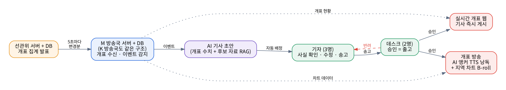</p>
<p align="center"><sub>서비스 흐름 — 승인 한 번으로 웹과 방송이 동시에 바뀜</sub></p>


| 항목 | 내용 |
|---|---|
| 버전 | v1.3 (2026-11-25) |
| 일정 | 예비발표 11/25 · 11/27 → 최종 발표 11/30 (20분 실시간 개표방송) |
| 설계 문서 | 아래 8개 항목을 눌러 펼쳐 보세요 (저장소별 문서는 각 저장소 README) (저장소별 문서는 각 저장소 README) (저장소별 문서는 각 저장소 README) · [Google Drive 폴더](https://drive.google.com/drive/folders/1_cBwKNgYjq68y6a8KJ1PvdjE484eh3fE) |

## 🗂️ 저장소 구성

| 저장소 | 역할 | 설계 문서 |
|---|---|---|
| [nec-server](https://github.com/journal-izm/nec-server) | 선관위 서버 — 개표 데이터 API·개표 시뮬레이터 (영역 02) | [Drive](https://drive.google.com/drive/folders/1Izs8LAkGqGRGMGK07rxIR9qtcB-rEDFs) · 저장소 README |
| [station-onair](https://github.com/journal-izm/station-onair) | 방송국 서버 — 수신·기사·승인·웹·송출 (영역 01·03~07), M·K 공용 | [Drive](https://drive.google.com/drive/folders/1nlaKXMnq60aUp-fv0_Upej-j6IBgHbLX) · 저장소 README |
| election-onair (여기) | 전체 설계 문서 8종 · 프로젝트 안내 | 아래 토글 |

두 저장소는 **API-02-01·API-02-02**로만 연결됩니다. 나눈 이유와 장단점은 01 기획서 10장에 있습니다.

## 📌 번호 체계

모든 번호의 **가운데 두 자리(영역 코드)**가 같으면 같은 기능 묶음입니다. 예) `REQ-05-02 → FN-05-02 → SCR-05-02 → API-05-02 → TBL-05-01` = 데스크 승인·출고

<p align="center">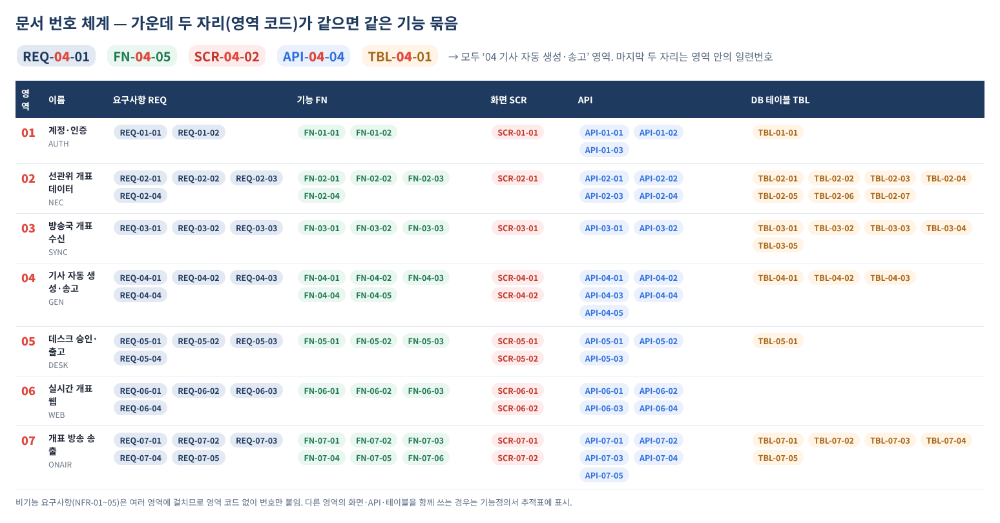</p>
<p align="center"><sub>영역 코드별 요구·기능·화면·API·테이블</sub></p>


| 코드 | 영역 | 설명 |
|---|---|---|
| 01 | 계정·인증 | 기자 3·데스크 2 계정 로그인과 역할별 접근 |
| 02 | 선관위 개표 데이터 | 선관위 서버가 선거·후보·지역·개표 집계를 제공 (개표 시뮬레이터 포함) |
| 03 | 방송국 개표 수신 | M·K 방송국 서버가 선관위 데이터를 받아 각자 DB에 저장하고 이벤트를 감지 |
| 04 | 기사 자동 생성·송고 | 개표 이벤트로 기사 초안을 자동 생성, 기자가 다듬어 데스크로 송고 |
| 05 | 데스크 승인·출고 | 데스크가 송고 기사를 승인(출고)하거나 반려 |
| 06 | 실시간 개표 웹 | 누구나 보는 개표 현황·지역 차트·실시간 기사 웹페이지 |
| 07 | 개표 방송 송출 | 20분 큐시트, AI 앵커 TTS 낭독, 지역 차트 B-roll, 영상 편성 |


## 📚 설계 문서

<details>
<summary><b>01 · 기획서 — 목적·흐름·방송 구성·일정</b></summary>

📄 원본: [Google Docs](https://docs.google.com/document/d/1bN2v6jyq0OCym9ecFwdPQ_GfTxGz9vtgRQZMXi6gSws/edit) · [Word 파일](docs/01_기획서.docx)

### 기획 포인트
- **실제 개표방송 재현**: 선관위 → 방송국 → 웹·방송 구조를 서버 3대·DB 3개로 만든다.
- **킥(차별점)**: 데스크가 ‘승인’을 누르는 순간 웹 기사와 AI 앵커 낭독이 동시에 바뀐다.
- **AI + 사람 검수**: AI는 초안만, 기자(사실 확인·수정)와 데스크(최종 승인) 두 사람을 거쳐야 나간다.
- **RAG 활용**: 후보 이력·공약 자료를 찾아 넣어 숫자만 나열하는 기사를 피한다.

### 용어
| 용어 | 뜻 |
|---|---|
| 송고(送稿) | 기자가 완성한 기사를 데스크에 보내는 것 (요청하신 ‘발재’의 정확한 용어) |
| 발제 | 취재 아이템을 회의에 제안하는 것 — 이 시스템에서는 쓰지 않음 |
| 승인 · 출고 | 데스크가 기사를 확인하고 내보내는 것. 승인 = 출고 = 웹 게시 + 방송 대기열 등록 |
| 반려 | 데스크가 사유를 적어 기자에게 되돌려 보내는 것 |
| 큐시트 | 방송 순서·시간을 적은 진행표 |
| B-roll | 앵커가 말하는 동안 함께 보여 주는 보조 화면 (여기서는 지역 차트) |
| TTS | 글을 음성으로 바꾸는 기술 (AI 앵커 목소리) |
| RAG | AI가 답하기 전에 자료(후보 이력·공약)를 찾아 참고하게 하는 방식 |
| SSE | 서버가 브라우저로 새 소식을 밀어 주는 방식. 새로고침 없이 화면이 바뀜 |
| seq | 선관위 집계가 갱신될 때마다 1씩 오르는 순번 |

### 참여 시스템과 사용자
| 구분 | 이름 | 하는 일 | 수 |
|---|---|---|---|
| 시스템 | 선관위 서버 + DB | 선거·후보·지역 정보와 개표 집계 제공, 개표 시뮬레이터 | 1 |
| 시스템 | M 방송국 서버 + DB | 개표 수신 → 이벤트 감지 → 기사 초안 → 승인 → 웹·방송 (주 시연) | 1 |
| 시스템 | K 방송국 서버 + DB | M과 같은 프로그램, 다른 설정(STATION_CODE=K) | 1 |
| 사용자 | 기자 | 초안 확인·수정·송고 (reporter1~3) | 3 |
| 사용자 | 데스크 | 승인(출고)·반려, 수신 모니터, 송출 제어 (desk1~2) | 2 |
| 사용자 | 시청자 | 실시간 개표 웹(로그인 없음), 개표방송 시청 | 누구나 |
| 운영 | 선관위 운영자 | 시뮬레이터 제어 (관리자 키) | 1 |

### 20분 방송 구성
<p align="center">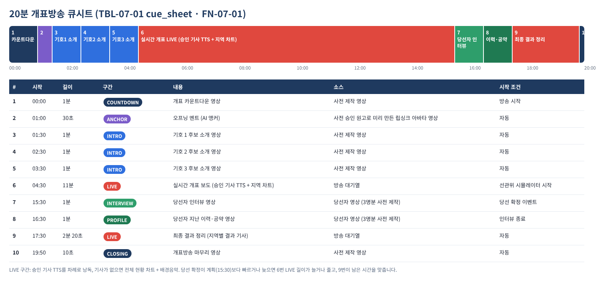</p>
<p align="center"><sub>20분 큐시트</sub></p>

### 미리 만들 영상·음성
| 종류 | 개수 | 길이 | 만드는 방법 |
|---|---|---|---|
| 개표 카운트다운 | 1 | 1분 | Runway + Suno, CapCut 편집 |
| 후보 소개 | 3 | 각 1분 | 후보 이력·공약 원고 → AI 영상 |
| 당선자 인터뷰 | 3 | 각 1분 | 당선자를 모르므로 3명분 준비 |
| 당선자 지난 이력·공약 | 3 | 각 1분 | RAG 자료와 같은 내용 |
| 개표방송 마무리 | 1 | 10초 | AI 영상 + 로고 |
| AI 앵커 루프 영상 | 1 | 10~20초 반복 | 음성은 TTS |
| 오프닝 멘트 음성 | 1 | 30초 | 미리 승인한 원고 → TTS |

### 개표 시나리오와 기사 분량
가상의 「2026 한빛시장 모의선거」 — 5개 구(별빛구, 심해구, 사막구, 성운구, 궤도구), 후보 3명(기호1 윤별하, 기호2 류해온, 기호3 오로라), 모두 가상.

#### 후보 설정
| 기호 | 후보 (정당) | 콘셉트 · 슬로건 | 이력 | 공약 | 색 |
|---|---|---|---|---|---|
| 1 | 윤별하 (은하공화연합) | 은하 함대 조종사 · “흩어진 별들을 하나의 항로로” | 은하 함대 정찰기 조종사 출신 / 소행성대 구조 작전 지휘 / 우주정거장 '은하1호' 사령관 / 은하공화연합 대표 | 구와 구를 5분 안에 잇는 '초공간 셔틀' 노선 / 구마다 함대식 재난 구조대 / 청소년 조종사 학교 설립 | #FF2BD6 |
| 2 | 류해온 (심해행성연맹) | 바다 행성의 수호자 · “가장 깊은 바다에서 온 약속” | 바다 행성 '아쿠아리스' 출신 / 심해 도시 방어막 설계 기술자 / 해저 잠수 함대 '해온호' 함장 / 심해행성연맹 대표 | 바닷속 쓰레기 수거 로봇 함대 / 해저 연구 도시 유치로 일자리 / 모든 행성 어린이 바다교실 무료 | #00E5FF |
| 3 | 오로라 (무소속) | 사막 행성의 외계 통역사 · “모든 종족의 목소리에 답하겠습니다” | 사막 행성의 외계 언어 통역사 / 정체불명 신호 '로라 신호' 해독 / 보조 로봇 '피코'와 우주 교역소 운영 / 첫 출마 | 외계 주민도 쓰는 '만능 번역 민원 창구' / 로봇이 24시간 답하는 구청 민원 / 우주 교역 시장 개설 | #A6FF00 |

> 후보·정당·지역은 모두 가상입니다. 우주 SF 분위기로 만들었지만 실존 영화·작품의 인물·행성 이름, 대사, 로고, 음악은 쓰지 않습니다. 색은 네온색이라 어두운 배경(방송 화면·차트)에서 쓰고, 흰 배경 글자에는 진한색을 씁니다.

| 이벤트 | 뜻 | 발생 조건 | 우선순위 |
|---|---|---|---|
| RATE_MILESTONE | 개표율 구간 돌파 | 전체 10·30·50·70·90·100%, 각 구 50·100% | 보통(5) |
| LEAD_CHANGE | 1위 변동 | 전체 또는 구에서 1위 후보가 바뀜 | 높음(3) |
| WIN_LIKELY | 당선 유력 | 개표율 50% 이상 + 1·2위 격차가 남은 표의 30% 이상 | 높음(2) |
| WIN_SURE | 당선 확실 | 1·2위 격차 > 남은 표의 60% (방송 판단 기준) | 최우선(1) |
| ELECTED | 당선 확정 | 1·2위 격차 > 남은 표 전부(수학적 확정) 또는 개표 100% | 최우선(1) |

기사 약 21~23건 × 방송 원고 20~30초 → LIVE 11분 안에 대부분 낭독, 같은 지역의 더 새로운 기사가 나오면 옛 기사는 건너뜀.

### 지켜야 할 원칙
- **사람 검수**: 기자 송고 + 데스크 승인 없이는 웹·방송에 나가지 않는다 (NFR-03)
- **근거 표시**: 기사를 만든 이벤트·개표 수치를 함께 보여 준다
- **시점 표기**: ‘개표율 50% 시점’처럼 기준 시점을 쓴다
- **가상 데이터 명시**: 화면에 ‘모의선거’ 표시
- **비밀 정보**: API 키는 .env, GitHub에 올리지 않는다

### 범위
| 포함 | 제외 |
|---|---|
| 선관위 개표 시뮬레이터와 API | 실제 중앙선관위 연동 |
| 기자 3·데스크 2 고정 계정 | 회원가입·비밀번호 찾기 |
| 기사 자동 생성(LLM + RAG)·송고·승인 | 여러 선거 동시 운영 |
| 실시간 개표 웹 (PC·모바일) | 앱 |
| 20분 송출 화면 + OBS | 립싱크 아바타 (선택) |

### 일정과 역할
<p align="center">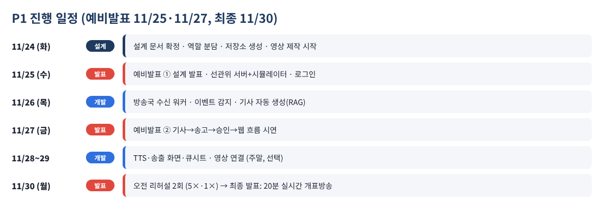</p>
<p align="center"><sub>P1 일정</sub></p>

| 역할(제안) | 맡는 일 | 영역 |
|---|---|---|
| 백엔드 A | 선관위 서버·시뮬레이터·시나리오 | 02 |
| 백엔드 B | 수신 워커·이벤트 감지·인증 | 01 · 03 |
| AI 담당 | 프롬프트·RAG·기사 생성·TTS | 04 · 07 |
| 프론트엔드 | 기자·데스크·공개 웹 화면 | 04 · 05 · 06 |
| 방송 담당 | 송출 화면·큐시트·OBS·영상 | 07 |

### 확인이 필요한 가정
- K 방송국도 기자 3·데스크 2 계정을 따로 둔다
- 당선자 인터뷰 영상은 1분
- 선거·후보·득표는 모두 가상 데이터 (시나리오 CSV만 바꾸면 실제 데이터 가능)
- 선관위 운영자는 관리자 키로 시뮬레이터를 다룬다

### 10. 저장소 구성: 2개로 나눌 때
선관위 서버와 방송국 서버를 서로 다른 GitHub 저장소로 나누는 안을 검토했다. K 방송국은 M 방송국과 같은 프로그램을 설정(STATION_CODE)만 바꿔 실행하므로, 방송국 저장소는 M사 전용이 아니라 M·K가 함께 쓰는 하나로 둔다.

| 저장소 | 담는 것 | 담당 |
|---|---|---|
| nec-server | 선관위 서버·개표 시뮬레이터·시나리오 CSV (영역 02) | 백엔드 A |
| station-onair | 방송국 서버·기자/데스크/공개 웹 화면·송출 화면 (영역 01·03~07), M·K 공용 | 나머지 팀원 |
| election-onair | 설계 문서 8종과 두 저장소 링크 (프로젝트 안내) | 강사 |

#### 장점과 단점
| 관점 | 장점 | 단점 |
|---|---|---|
| 현실성 | 실제처럼 선관위와 방송사가 다른 조직으로 분리되고, 약속한 API로만 연결된다 | — |
| 팀 분담 | 담당 저장소만 보면 되어 역할이 분명하고 코드 충돌(merge conflict)이 줄어든다 | 두 팀이 서로의 진행 상황을 따로 챙겨야 한다 |
| 실행·배포 | 선관위 서버를 먼저 띄워 두고 방송국은 그 주소만 받아 독립적으로 개발할 수 있다 | 로컬에서 전체를 돌리려면 저장소 2개를 각각 받아 실행해야 한다 |
| API 변경 | API 명세가 저장소 사이의 계약이 되어 명세서를 지키는 습관이 생긴다 | 응답 형식을 바꾸면 두 저장소를 함께 고쳐야 한다(PR 2개) |
| 관리 부담 | — | README·.gitignore·.env.example·실행 방법을 저장소마다 따로 관리한다 |
| 일정 | — | 11/30 발표까지 개발 기간이 4~5일이라 저장소 관리에 드는 시간만큼 개발 시간이 줄어든다 |

#### 결정 기준
기관 사이의 분리를 실제처럼 경험하는 것이 수업 목표라면 2개로 나누는 편이 좋다. 발표 날 방송을 안정적으로 내보내는 것이 우선이면 한 저장소에 폴더로 나누는 편이 관리가 쉽다. 2개로 나눌 경우 개발 첫날 선관위 API(API-02-01~04)의 요청·응답 형식을 확정하고, 이후에는 되도록 바꾸지 않는다.
<details>
<summary><b>✅ 테스트케이스 — 1차 확인 (시나리오 테스트 6개)</b></summary>

20분 방송을 처음부터 끝까지 돌려 보며 큰 흐름이 맞는지 확인합니다. 단계: 1 선관위 서버 · 2 방송국 수신·웹 · 3 기사 흐름 · 4 송출 · 5 마무리

| 번호 | 단계 | 확인할 것 | 절차 | 기대 결과 | 근거 | 방식 |
|---|---|---|---|---|---|---|
| TC-SC-01 | 4 | 20분 방송 한 바퀴 (5배속 리허설) | 모두 초기화 → 데스크가 송출 시작 → LIVE가 시작될 때(방송 4:30) 시뮬레이터 5배속 시작. 기사가 나오면 기자 송고·데스크 승인을 계속한다. | 카운트다운 → 오프닝 → 후보 소개 3개 → LIVE → 당선 확정 기사 → 인터뷰·이력·공약 → 최종 정리 → 마무리 순서로 멈춤 없이 끝난다. 5배속은 개표만 빨라지고 영상 구간은 실제 길이라 전체 약 12분. | REQ-07-01, REQ-07-04, NFR-04 | 수동 |
| TC-SC-02 | 2 | 같은 결과 다시 재현 | 리허설을 2번 한다. 두 번 모두 같은 시점에 개표율·1위·이벤트를 적어 둔다. | 1위 변동·당선 확정이 두 번 모두 같은 시점, 같은 후보로 나온다. | NFR-04, REQ-02-04 | 수동 |
| TC-SC-03 | 4 | 기사 한 건의 한 바퀴 | 이벤트 발생 → 초안이 기자에게 배정 → 기자 수정·송고 → 데스크 승인. | 승인 후 3초 안에 웹에 기사가 뜨고, 15초 안에 방송 대기열에 들어가 AI 앵커가 읽는다. | REQ-04-01, REQ-04-04, REQ-05-02, NFR-01 | 수동 |
| TC-SC-04 | 3 | 반려 후 다시 송고 | 데스크가 사유를 적어 반려 → 기자 화면 확인 → 고쳐서 다시 송고 → 승인. | 기자 화면에 반려 사유가 보이고, 다시 송고한 기사가 승인 대기 목록 맨 뒤에 들어간다. | REQ-05-03, REQ-04-04 | 수동 |
| TC-SC-05 | 4 | 당선 확정이 늦을 때 (BR-10) | 시뮬레이터를 일시정지해 방송 16:30까지 당선 확정이 나오지 않게 한다. | 데스크가 인터뷰·이력 영상을 건너뛰고 LIVE를 이어 갈 수 있다. 화면이 멈추지 않는다. | REQ-07-05, REQ-07-04 | 수동 |
| TC-SC-06 | 5 | 클라우드 시연 모드 | DEMO_MODE=1로 배포한 주소에 처음 접속한다. | 1분 안에 깨어나고, 아무도 누르지 않아도 개표가 시작돼 끝나면 처음부터 반복한다. | REQ-02-05 | 수동 |


</details>


</details>

<details>
<summary><b>02 · 요구사항정의서 — 요구 33개와 추적표</b></summary>

📄 원본: [Google Docs](https://docs.google.com/document/d/1_0ILv4XYF0Fx3Fci5U1H6TyZc6FFWBHuaANvV2D6e9M/edit) · [Word 파일](docs/02_요구사항정의서.docx)

### 영역 01 · 계정·인증
| 요구 ID | 요구사항명 | 내용 | 우선순위 | 관련 기능 |
|---|---|---|---|---|
| REQ-01-01 | 고정 계정 운영 | 회원가입 없이 기자 3개(reporter1~3)·데스크 2개(desk1~2) 계정만 미리 만들어 둔다. | 필수 | FN-01-01 |
| REQ-01-02 | 역할별 접근 제어 | 기자는 기사 작성·송고 화면만, 데스크는 승인·송출 제어 화면만 쓸 수 있다. | 필수 | FN-01-01 FN-01-02 |

### 영역 02 · 선관위 개표 데이터
| 요구 ID | 요구사항명 | 내용 | 우선순위 | 관련 기능 |
|---|---|---|---|---|
| REQ-02-01 | 선거 기본정보 제공 | 선관위 서버는 선거·지역(5개 구)·후보(3명) 기본정보를 API로 제공한다. | 필수 | FN-02-01 |
| REQ-02-02 | 개표 집계 변경분 제공 | 선관위 서버는 지역·후보별 득표와 개표율을 갱신하고, 순번(seq) 이후의 변경분만 내려준다. | 필수 | FN-02-02 |
| REQ-02-03 | 방송국 인증 | 선관위 API는 등록된 방송국(M·K)이 발급받은 API 키로만 호출할 수 있다. | 필수 | FN-02-03 |
| REQ-02-04 | 개표 시뮬레이터 | 리허설·방송을 위해 개표 진행을 시작·일시정지·배속·초기화할 수 있다. | 필수 | FN-02-04 |
| REQ-02-05 | 클라우드 시연 모드 | 클라우드 배포본은 서버가 켜질 때 초기 데이터를 넣고 개표 시나리오를 자동으로 반복 재생한다. | 권장 | FN-02-04 |

### 영역 03 · 방송국 개표 수신
| 요구 ID | 요구사항명 | 내용 | 우선순위 | 관련 기능 |
|---|---|---|---|---|
| REQ-03-01 | 주기적 개표 수신 | M·K 방송국 서버는 5초마다 선관위 변경분을 받아 각자의 DB에 저장한다. | 필수 | FN-03-01 |
| REQ-03-02 | 개표 이벤트 감지 | 개표율 구간 돌파·1위 변동·당선 유력/확실/확정을 감지해 이벤트로 기록한다. | 필수 | FN-03-02 |
| REQ-03-03 | 수신 상태 확인 | 마지막 수신 시각·실패 횟수를 보여 주고, 실패하면 자동으로 다시 시도한다. | 권장 | FN-03-03 |

### 영역 04 · 기사 자동 생성·송고
| 요구 ID | 요구사항명 | 내용 | 우선순위 | 관련 기능 |
|---|---|---|---|---|
| REQ-04-01 | 기사 초안 자동 생성 | 이벤트가 생기면 개표 수치와 후보 이력·공약(RAG)으로 기사 초안을 자동 생성한다. | 필수 | FN-04-01 |
| REQ-04-02 | 방송 원고 동시 생성 | 웹 기사 본문과 함께 AI 앵커가 읽을 짧은 방송 원고(20~30초 분량)를 만든다. | 필수 | FN-04-01 |
| REQ-04-03 | 기자 자동 배정 | 생성된 초안은 기자 3명에게 차례로 자동 배정된다. | 필수 | FN-04-02 FN-04-03 |
| REQ-04-04 | 기사 수정·송고 | 기자는 초안을 확인·수정한 뒤 데스크로 송고한다. 반려 기사는 다시 고쳐 송고할 수 있다. | 필수 | FN-04-03 FN-04-04 FN-04-05 |

### 영역 05 · 데스크 승인·출고
| 요구 ID | 요구사항명 | 내용 | 우선순위 | 관련 기능 |
|---|---|---|---|---|
| REQ-05-01 | 송고 기사 확인 | 데스크는 송고된 기사를 도착 순서대로 보고 내용을 검토한다. | 필수 | FN-05-01 |
| REQ-05-02 | 승인 즉시 출고 | 데스크가 승인하면 기사는 바로 실시간 웹에 게시되고 방송 대기열에 들어간다. | 필수 | FN-05-02 |
| REQ-05-03 | 반려 | 데스크는 사유를 적어 반려할 수 있고, 기사는 담당 기자에게 돌아간다. | 필수 | FN-05-03 |
| REQ-05-04 | 검토 이력 | 누가 언제 승인·반려했는지 기록을 남긴다. | 권장 | FN-05-03 |

### 영역 06 · 실시간 개표 웹
| 요구 ID | 요구사항명 | 내용 | 우선순위 | 관련 기능 |
|---|---|---|---|---|
| REQ-06-01 | 전체 개표 현황 | 웹에서 전체 개표율·후보별 득표수·득표율·순위를 보여 준다. | 필수 | FN-06-01 |
| REQ-06-02 | 지역별 결과 | 5개 구의 1위 후보를 지도·차트로 보여 주고, 구를 누르면 상세 결과를 본다. | 필수 | FN-06-02 |
| REQ-06-03 | 실시간 기사 피드 | 승인된 기사가 새로고침 없이 웹에 바로 나타난다. | 필수 | FN-06-03 |
| REQ-06-04 | 공개 열람 | 실시간 개표 웹은 로그인 없이 누구나 볼 수 있다. | 필수 | FN-06-01 |

### 영역 07 · 개표 방송 송출
| 요구 ID | 요구사항명 | 내용 | 우선순위 | 관련 기능 |
|---|---|---|---|---|
| REQ-07-01 | 20분 큐시트 송출 | 카운트다운 1분 → 후보 소개 1분×3 → 실시간 개표 → 당선자 인터뷰 → 이력·공약 1분 → 마무리 10초 순서로 송출한다. | 필수 | FN-07-01 FN-07-03 |
| REQ-07-02 | AI 앵커 TTS 낭독 | 승인된 기사의 방송 원고를 TTS 음성으로 만들어 AI 앵커가 읽는다. | 필수 | FN-07-02 FN-07-03 |
| REQ-07-03 | 지역 차트 B-roll | 기사를 읽는 동안 그 기사의 지역 차트가 화면에 나온다. | 필수 | FN-07-04 |
| REQ-07-04 | 당선 영상 자동 편성 | 당선 확정 기사가 나가면 당선자의 인터뷰·이력·공약 영상을 이어서 편성한다. | 필수 | FN-07-05 |
| REQ-07-05 | 송출 제어 | 데스크는 송출 시작·일시정지·다음 항목 건너뛰기를 할 수 있다. | 필수 | FN-07-06 |
| REQ-07-06 | 립싱크 아바타 | 오프닝·마무리 멘트와 당선 유력·확실·확정 기사는 립싱크 아바타 영상으로 낭독한다. 영상이 90초 안에 준비되지 않으면 앵커 영상 + TTS로 먼저 읽는다. | 필수 | FN-07-07 |

### 비기능 요구사항
| 요구 ID | 구분 | 요구사항명 | 내용 | 관련 기능 |
|---|---|---|---|---|
| NFR-01 | 성능 | 출고 지연 시간 | 승인 후 웹 표시 3초 이내, 방송 대기열 등록(TTS 생성 포함) 15초 이내. 아바타 대상 기사는 90초 이내(넘으면 TTS로 대체). | FN-05-02 FN-07-07 |
| NFR-02 | 보안 | 비밀 정보 보호 | 비밀번호는 해시로 저장, API 키·OpenAI 키는 .env에 두고 Git에 올리지 않는다. | FN-01-01 FN-02-03 |
| NFR-03 | 윤리 | 사람 검수 원칙 | AI가 만든 기사는 기자·데스크 두 사람의 확인 없이 웹·방송에 나가지 않는다. | FN-04-05 FN-05-02 |
| NFR-04 | 운영 | 반복 리허설 | 시뮬레이터 초기화로 같은 개표 시나리오를 몇 번이고 다시 재현할 수 있다. | FN-02-04 |
| NFR-05 | 화면 | 화면 규격 | 송출 화면 1920×1080, 실시간 개표 웹은 모바일에서도 읽힌다. | FN-06-01 FN-07-03 |

### 요구사항 추적표
| 요구 ID | 기능 | 화면 | API | 테이블 |
|---|---|---|---|---|
| REQ-01-01 | FN-01-01 | SCR-01-01 | API-01-01 | TBL-01-01 |
| REQ-01-02 | FN-01-01 FN-01-02 | SCR-01-01 | API-01-01, API-01-02, API-01-03 | TBL-01-01 |
| REQ-02-01 | FN-02-01 | — | API-02-01 | TBL-02-01, TBL-02-02, TBL-02-03 |
| REQ-02-02 | FN-02-02 | — | API-02-02 | TBL-02-04, TBL-02-05 |
| REQ-02-03 | FN-02-03 | — | API-02-01, API-02-02 | TBL-02-06 |
| REQ-02-04 | FN-02-04 | SCR-02-01 | API-02-03, API-02-04 | TBL-02-04, TBL-02-05, TBL-02-07 |
| REQ-02-05 | FN-02-04 | SCR-02-01 | API-02-03, API-02-04 | TBL-02-04, TBL-02-05, TBL-02-07 |
| REQ-03-01 | FN-03-01 | — | API-02-02 | TBL-03-01, TBL-03-02, TBL-03-03, TBL-03-05 |
| REQ-03-02 | FN-03-02 | — | — | TBL-03-03, TBL-03-04 |
| REQ-03-03 | FN-03-03 | SCR-03-01 | API-03-01, API-03-02 | TBL-03-05 |
| REQ-04-01 | FN-04-01 | — | — | TBL-03-04, TBL-04-01, TBL-04-02, TBL-04-03 |
| REQ-04-02 | FN-04-01 | — | — | TBL-03-04, TBL-04-01, TBL-04-02, TBL-04-03 |
| REQ-04-03 | FN-04-02 FN-04-03 | SCR-04-01 | API-04-01, API-04-05 | TBL-01-01, TBL-04-01 |
| REQ-04-04 | FN-04-03 FN-04-04 FN-04-05 | SCR-04-01, SCR-04-02 | API-04-01, API-04-02, API-04-03, API-04-04, API-04-05 | TBL-04-01 |
| REQ-05-01 | FN-05-01 | SCR-05-01 | API-04-05, API-05-01 | TBL-04-01 |
| REQ-05-02 | FN-05-02 | SCR-05-02 | API-05-02 | TBL-04-01, TBL-05-01, TBL-07-02, TBL-07-04 |
| REQ-05-03 | FN-05-03 | SCR-05-02 | API-05-03 | TBL-04-01, TBL-05-01 |
| REQ-05-04 | FN-05-03 | SCR-05-02 | API-05-03 | TBL-04-01, TBL-05-01 |
| REQ-06-01 | FN-06-01 | SCR-06-01 | API-06-01 | TBL-03-01, TBL-03-03 |
| REQ-06-02 | FN-06-02 | SCR-06-01, SCR-06-02 | API-06-02 | TBL-03-02, TBL-03-03 |
| REQ-06-03 | FN-06-03 | SCR-06-01, SCR-06-02 | API-06-03, API-06-04 | TBL-04-01 |
| REQ-06-04 | FN-06-01 | SCR-06-01 | API-06-01 | TBL-03-01, TBL-03-03 |
| REQ-07-01 | FN-07-01 FN-07-03 | SCR-07-01, SCR-07-02 | API-07-01, API-07-02, API-07-03, API-07-05 | TBL-07-01, TBL-07-02, TBL-07-03 |
| REQ-07-02 | FN-07-02 FN-07-03 | SCR-07-01 | API-07-02, API-07-03, API-07-05 | TBL-07-01, TBL-07-02, TBL-07-04 |
| REQ-07-03 | FN-07-04 | SCR-07-01 | API-06-02 | TBL-03-03 |
| REQ-07-04 | FN-07-05 | SCR-07-01, SCR-07-02 | API-07-02 | TBL-03-04, TBL-07-01, TBL-07-03 |
| REQ-07-05 | FN-07-06 | SCR-07-02 | API-07-04, API-07-05 | TBL-07-05 |
| REQ-07-06 | FN-07-07 | SCR-07-01, SCR-07-02 | API-07-02 | TBL-07-02, TBL-07-04, TBL-07-06 |
| NFR-01 | FN-05-02 FN-07-07 | SCR-05-02, SCR-07-01, SCR-07-02 | API-05-02, API-07-02 | TBL-04-01, TBL-05-01, TBL-07-02, TBL-07-04, TBL-07-06 |
| NFR-02 | FN-01-01 FN-02-03 | SCR-01-01 | API-01-01, API-02-01, API-02-02 | TBL-01-01, TBL-02-06 |
| NFR-03 | FN-04-05 FN-05-02 | SCR-04-02, SCR-05-02 | API-04-04, API-05-02 | TBL-04-01, TBL-05-01, TBL-07-02, TBL-07-04 |
| NFR-04 | FN-02-04 | SCR-02-01 | API-02-03, API-02-04 | TBL-02-04, TBL-02-05, TBL-02-07 |
| NFR-05 | FN-06-01 FN-07-03 | SCR-06-01, SCR-07-01 | API-06-01, API-07-02, API-07-03, API-07-05 | TBL-03-01, TBL-03-03, TBL-07-01, TBL-07-02 |

<details>
<summary><b>✅ 테스트케이스 — 1차 확인 (인수 테스트 7개)</b></summary>

요구사항(특히 권한·보안·속도 같은 비기능)을 지켰는지 확인합니다. 아래 추적표로 모든 요구사항이 한 번 이상 확인되는지 봅니다. 단계: 1 선관위 서버 · 2 방송국 수신·웹 · 3 기사 흐름 · 4 송출 · 5 마무리

| 번호 | 단계 | 확인할 것 | 절차 | 기대 결과 | 근거 | 방식 |
|---|---|---|---|---|---|---|
| TC-RQ-01 | 2 | 고정 계정 5개 | reporter1~3, desk1~2로 차례로 로그인하고, 없는 아이디로도 시도한다. | 5개 계정만 로그인된다. 회원가입 버튼이나 주소는 없다. | REQ-01-01 | 자동 |
| TC-RQ-02 | 3 | 역할별 접근 | 기자 계정으로 데스크 화면·승인 API를, 데스크 계정으로 송고 API를 연다. | 화면은 로그인 화면으로 돌아가고, API는 403을 돌려준다. | REQ-01-02 | 자동 |
| TC-RQ-03 | 3 | 사람 검수 원칙 (BR-01) | DRAFT·SUBMITTED·REJECTED 기사를 하나씩 만든 뒤 공개 기사 API와 방송 대기열을 조회한다. | 승인(APPROVED)되지 않은 기사는 어디에도 나오지 않는다. | NFR-03 | 자동 |
| TC-RQ-04 | 4 | 출고 지연 시간 | 기사 10건을 승인하고, 승인 시각·웹 표시 시각·대기열 등록 시각을 로그에서 비교한다. | 웹 표시는 3초 안, 대기열 등록(TTS 포함)은 15초 안이다. | NFR-01 | 수동 |
| TC-RQ-05 | 1 | 비밀 정보 보호 | users 표의 비밀번호 칸과 서버 로그를 살펴본다. | 비밀번호는 해시로만 저장되고, API 키·OpenAI 키가 로그에 찍히지 않는다. | NFR-02 | 자동 |
| TC-RQ-06 | 2 | 누구나 보는 웹 | 시크릿 창과 휴대폰 폭(390px)에서 실시간 개표 웹을 연다. | 로그인 없이 보이고, 휴대폰 폭에서도 글자·숫자가 잘리지 않는다. | REQ-06-04, NFR-05 | 수동 |
| TC-RQ-07 | 4 | 송출 화면 규격 | 1920×1080 창에서 송출 화면을 연다. | 스크롤 없이 화면에 꼭 맞고, 잘리는 요소가 없다. | NFR-05 | 수동 |

**요구사항 → 확인 테스트**

| 요구사항 | 이름 | 확인하는 테스트 |
|---|---|---|
| REQ-01-01 | 고정 계정 운영 | TC-RQ-01, TC-UI-01 |
| REQ-01-02 | 역할별 접근 제어 | TC-RQ-02, TC-UI-01 |
| REQ-02-01 | 선거 기본정보 제공 | TC-API-01, TC-API-02 |
| REQ-02-02 | 개표 집계 변경분 제공 | TC-API-01, TC-API-03, TC-FN-01 |
| REQ-02-03 | 방송국 인증 | TC-API-01, TC-API-02, TC-API-03 |
| REQ-02-04 | 개표 시뮬레이터 | TC-API-04, TC-SC-02, TC-UI-02 |
| REQ-02-05 | 클라우드 시연 모드 | TC-API-04, TC-ENV-05, TC-SC-06, TC-UI-02 |
| REQ-03-01 | 주기적 개표 수신 | TC-API-01, TC-API-03, TC-DB-03, TC-SYS-01, TC-SYS-02 |
| REQ-03-02 | 개표 이벤트 감지 | TC-FN-02, TC-FN-03 |
| REQ-03-03 | 수신 상태 확인 | TC-SYS-03, TC-UI-03 |
| REQ-04-01 | 기사 초안 자동 생성 | TC-ENV-06, TC-FN-10, TC-SC-03, TC-SYS-04 |
| REQ-04-02 | 방송 원고 동시 생성 | TC-FN-10 |
| REQ-04-03 | 기자 자동 배정 | TC-FN-04, TC-UI-04 |
| REQ-04-04 | 기사 수정·송고 | TC-API-05, TC-FN-05, TC-SC-03, TC-SC-04, TC-UI-04 |
| REQ-05-01 | 송고 기사 확인 | TC-UI-05 |
| REQ-05-02 | 승인 즉시 출고 | TC-API-05, TC-API-06, TC-FN-06, TC-SC-03, TC-UI-05 |
| REQ-05-03 | 반려 | TC-FN-06, TC-SC-04, TC-UI-05 |
| REQ-05-04 | 검토 이력 | TC-DB-05, TC-FN-06, TC-UI-05 |
| REQ-06-01 | 전체 개표 현황 | TC-API-07, TC-UI-06 |
| REQ-06-02 | 지역별 결과 | TC-API-07, TC-UI-06, TC-UI-07 |
| REQ-06-03 | 실시간 기사 피드 | TC-API-06, TC-API-08, TC-SYS-05, TC-UI-06, TC-UI-07 |
| REQ-06-04 | 공개 열람 | TC-API-07, TC-ENV-04, TC-RQ-06, TC-UI-06 |
| REQ-07-01 | 20분 큐시트 송출 | TC-API-09, TC-FN-07, TC-SC-01, TC-UI-08, TC-UI-09 |
| REQ-07-02 | AI 앵커 TTS 낭독 | TC-API-09, TC-ENV-07, TC-FN-07, TC-FN-08, TC-SYS-06, TC-UI-08 |
| REQ-07-03 | 지역 차트 B-roll | TC-API-07, TC-UI-08 |
| REQ-07-04 | 당선 영상 자동 편성 | TC-API-09, TC-SC-01, TC-SC-05, TC-UI-08, TC-UI-09 |
| REQ-07-05 | 송출 제어 | TC-SC-05, TC-UI-09 |
| REQ-07-06 | 립싱크 아바타 | TC-API-09, TC-FN-09, TC-UI-08, TC-UI-09 |
| NFR-01 | 출고 지연 시간 | TC-API-05, TC-API-06, TC-API-09, TC-FN-06, TC-FN-09, TC-RQ-04, TC-SC-03, TC-UI-05, TC-UI-08, TC-UI-09 |
| NFR-02 | 비밀 정보 보호 | TC-API-01, TC-API-02, TC-API-03, TC-ENV-01, TC-ENV-02, TC-ENV-03, TC-RQ-05, TC-UI-01 |
| NFR-03 | 사람 검수 원칙 | TC-API-05, TC-API-06, TC-FN-05, TC-FN-06, TC-RQ-03, TC-UI-04, TC-UI-05 |
| NFR-04 | 반복 리허설 | TC-API-04, TC-SC-01, TC-SC-02, TC-UI-02 |
| NFR-05 | 화면 규격 | TC-API-07, TC-API-09, TC-FN-07, TC-RQ-06, TC-RQ-07, TC-SYS-06, TC-UI-06, TC-UI-08 |


</details>


</details>

<details>
<summary><b>03 · 기능정의서 — 기능 27개·상태 전이·업무 규칙</b></summary>

📄 원본: [Google Docs](https://docs.google.com/document/d/1lABK1dEWJ_0QszNPkz6_2PwyjnZoPAttZj077tA1r6s/edit) · [Word 파일](docs/03_기능정의서.docx)

<p align="center">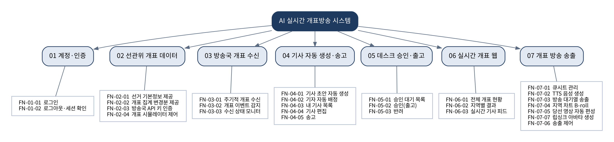</p>
<p align="center"><sub>기능 구조도</sub></p>

### 영역 01 · 계정·인증
기자 3·데스크 2 계정 로그인과 역할별 접근

| 기능 ID | 기능명 | 설명 | 요구 | 화면 | API | 테이블 |
|---|---|---|---|---|---|---|
| FN-01-01 | 로그인 | 아이디·비밀번호로 로그인, 역할(기자/데스크)에 맞는 첫 화면으로 이동 | REQ-01-01 REQ-01-02 NFR-02 | SCR-01-01 | API-01-01 | TBL-01-01 |
| FN-01-02 | 로그아웃·세션 확인 | 로그아웃, 새로고침 시 로그인 상태와 역할 확인 | REQ-01-02 | SCR-01-01 | API-01-02 API-01-03 | TBL-01-01 |

### 영역 02 · 선관위 개표 데이터
선관위 서버가 선거·후보·지역·개표 집계를 제공 (개표 시뮬레이터 포함)

| 기능 ID | 기능명 | 설명 | 요구 | 화면 | API | 테이블 |
|---|---|---|---|---|---|---|
| FN-02-01 | 선거 기본정보 제공 | 선거·지역·후보 정보를 방송국에 제공 | REQ-02-01 | — | API-02-01 | TBL-02-01 TBL-02-02 TBL-02-03 |
| FN-02-02 | 개표 집계 변경분 제공 | since_seq 이후 바뀐 지역·후보 집계만 응답 | REQ-02-02 | — | API-02-02 | TBL-02-04 TBL-02-05 |
| FN-02-03 | 방송국 API 키 인증 | X-API-KEY 헤더를 등록된 키와 대조 | REQ-02-03 NFR-02 | — | API-02-01 API-02-02 | TBL-02-06 |
| FN-02-04 | 개표 시뮬레이터 제어 | 시나리오에 따라 집계를 늘림. 시작·일시정지·배속·초기화. 시연 모드(DEMO_MODE)에서는 자동 시작·반복 | REQ-02-04 REQ-02-05 NFR-04 | SCR-02-01 | API-02-03 API-02-04 | TBL-02-07 TBL-02-04 TBL-02-05 |

### 영역 03 · 방송국 개표 수신
M·K 방송국 서버가 선관위 데이터를 받아 각자 DB에 저장하고 이벤트를 감지

| 기능 ID | 기능명 | 설명 | 요구 | 화면 | API | 테이블 |
|---|---|---|---|---|---|---|
| FN-03-01 | 주기적 개표 수신 | 5초마다 선관위 API 호출 → 최신 결과 표 갱신 | REQ-03-01 | — | API-02-02 | TBL-03-01 TBL-03-02 TBL-03-03 TBL-03-05 |
| FN-03-02 | 개표 이벤트 감지 | 직전 값과 비교해 이벤트(구간 돌파·1위 변동·당선) 기록 | REQ-03-02 | — | — | TBL-03-03 TBL-03-04 |
| FN-03-03 | 수신 상태 모니터 | 마지막 수신 시각·seq·실패 횟수 표시, 수동 즉시 수신 | REQ-03-03 | SCR-03-01 | API-03-01 API-03-02 | TBL-03-05 |

### 영역 04 · 기사 자동 생성·송고
개표 이벤트로 기사 초안을 자동 생성, 기자가 다듬어 데스크로 송고

| 기능 ID | 기능명 | 설명 | 요구 | 화면 | API | 테이블 |
|---|---|---|---|---|---|---|
| FN-04-01 | 기사 초안 자동 생성 | 이벤트 유형별 프롬프트 + 후보 자료 검색(RAG) → 제목·본문·방송 원고 생성 | REQ-04-01 REQ-04-02 | — | — | TBL-03-04 TBL-04-01 TBL-04-02 TBL-04-03 |
| FN-04-02 | 기자 자동 배정 | 기자 3명에게 차례로 배정하되, 미처리 초안이 3건 이상인 기자는 건너뜀 | REQ-04-03 | — | — | TBL-04-01 TBL-01-01 |
| FN-04-03 | 내 기사 목록 | 배정된 초안·반려 기사·송고 기사를 상태별로 조회 | REQ-04-03 REQ-04-04 | SCR-04-01 | API-04-01 API-04-05 | TBL-04-01 |
| FN-04-04 | 기사 편집 | 제목·본문·방송 원고 수정 및 임시 저장 | REQ-04-04 | SCR-04-02 | API-04-02 API-04-03 | TBL-04-01 |
| FN-04-05 | 송고 | 기사를 데스크로 보냄 (상태 DRAFT/REJECTED → SUBMITTED) | REQ-04-04 NFR-03 | SCR-04-02 | API-04-04 | TBL-04-01 |

### 영역 05 · 데스크 승인·출고
데스크가 송고 기사를 승인(출고)하거나 반려

| 기능 ID | 기능명 | 설명 | 요구 | 화면 | API | 테이블 |
|---|---|---|---|---|---|---|
| FN-05-01 | 승인 대기 목록 | 송고 기사를 도착 순으로 조회, 새 송고 알림 | REQ-05-01 | SCR-05-01 | API-05-01 API-04-05 | TBL-04-01 |
| FN-05-02 | 승인(출고) | 승인 → 웹 게시 + TTS 생성 + 방송 대기열 등록 | REQ-05-02 NFR-01 NFR-03 | SCR-05-02 | API-05-02 | TBL-04-01 TBL-05-01 TBL-07-02 TBL-07-04 |
| FN-05-03 | 반려 | 사유와 함께 담당 기자에게 반환 | REQ-05-03 REQ-05-04 | SCR-05-02 | API-05-03 | TBL-04-01 TBL-05-01 |

### 영역 06 · 실시간 개표 웹
누구나 보는 개표 현황·지역 차트·실시간 기사 웹페이지

| 기능 ID | 기능명 | 설명 | 요구 | 화면 | API | 테이블 |
|---|---|---|---|---|---|---|
| FN-06-01 | 전체 개표 현황 | 전체 개표율·후보별 득표·순위 표시 | REQ-06-01 REQ-06-04 NFR-05 | SCR-06-01 | API-06-01 | TBL-03-01 TBL-03-03 |
| FN-06-02 | 지역별 결과 | 구별 1위 지도와 구 상세 차트 | REQ-06-02 | SCR-06-01 SCR-06-02 | API-06-02 | TBL-03-02 TBL-03-03 |
| FN-06-03 | 실시간 기사 피드 | 승인 기사 목록 + SSE로 새 기사·결과 갱신 받기 | REQ-06-03 | SCR-06-01 SCR-06-02 | API-06-03 API-06-04 | TBL-04-01 |

### 영역 07 · 개표 방송 송출
20분 큐시트, AI 앵커 TTS 낭독, 지역 차트 B-roll, 영상 편성

| 기능 ID | 기능명 | 설명 | 요구 | 화면 | API | 테이블 |
|---|---|---|---|---|---|---|
| FN-07-01 | 큐시트 관리 | 20분 구성표와 영상 파일 확인·순서 조정 | REQ-07-01 | SCR-07-02 | API-07-01 | TBL-07-01 TBL-07-03 |
| FN-07-02 | TTS 음성 생성 | 방송 원고를 앵커 음성 파일로 변환. 실패하거나 음성이 예상보다 짧으면(끝 문장 잘림) 1회 다시 생성 | REQ-07-02 | — | — | TBL-07-04 |
| FN-07-03 | 방송 대기열 송출 | 송출 화면이 다음 항목(영상/TTS)을 받아 재생 후 완료 보고. 같은 지역·유형의 더 새로운 기사가 승인되면 옛 기사는 건너뜀(SKIPPED) | REQ-07-01 REQ-07-02 NFR-05 | SCR-07-01 | API-07-02 API-07-03 API-07-05 | TBL-07-01 TBL-07-02 |
| FN-07-04 | 지역 차트 B-roll | 낭독 중인 기사의 지역 차트를 화면에 표시 | REQ-07-03 | SCR-07-01 | API-06-02 | TBL-03-03 |
| FN-07-05 | 당선 영상 자동 편성 | 당선 확정 기사 송출 뒤 당선자 인터뷰·이력·공약 영상 연결 | REQ-07-04 | SCR-07-01 SCR-07-02 | API-07-02 | TBL-07-01 TBL-07-03 TBL-03-04 |
| FN-07-07 | 립싱크 아바타 생성 | 당선 관련 기사의 방송 원고로 아바타 영상을 요청하고, 90초 안에 준비되면 아바타로, 아니면 TTS로 송출 | REQ-07-06 NFR-01 | SCR-07-01 SCR-07-02 | API-07-02 | TBL-07-06 TBL-07-02 TBL-07-04 |
| FN-07-06 | 송출 제어 | 시작·일시정지·재개·건너뛰기, 현재 상태 표시 | REQ-07-05 | SCR-07-02 | API-07-04 API-07-05 | TBL-07-05 |

### 기사 상태 전이
<p align="center">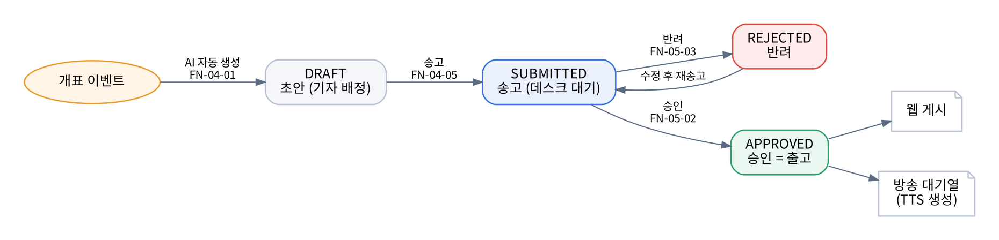</p>
<p align="center"><sub>기사 상태 — DRAFT → SUBMITTED → APPROVED / REJECTED</sub></p>

| 상태 | 뜻 | 누가 바꾸나 | 다음 상태 |
|---|---|---|---|
| DRAFT | AI 초안, 기자 배정 | 시스템(FN-04-01) | SUBMITTED |
| SUBMITTED | 송고됨, 데스크 대기 | 기자(FN-04-05) | APPROVED, REJECTED |
| REJECTED | 반려됨 | 데스크(FN-05-03) | SUBMITTED |
| APPROVED | 승인 = 출고 (웹 게시 + 방송 대기열) | 데스크(FN-05-02) | (끝) |

### 업무 규칙
| 규칙 | 이름 | 내용 | 관련 기능 |
|---|---|---|---|
| BR-01 | 사람 검수 | APPROVED가 아닌 기사는 공개 API(API-06-03)·방송 대기열에 절대 나오지 않는다. | FN-05-02, FN-06-03 |
| BR-02 | 담당자만 수정 | 기자는 자기에게 배정된 기사만 수정·송고할 수 있다. 다른 기자 기사는 403. | FN-04-04, FN-04-05 |
| BR-03 | 수정 가능 상태 | DRAFT·REJECTED 상태에서만 수정 가능. SUBMITTED 이후 수정 요청은 409. | FN-04-04 |
| BR-04 | 동시 승인 방지 | 데스크 2명이 같은 기사를 동시에 처리하면 먼저 처리한 쪽만 반영, 나머지는 409 ‘이미 처리됨’. | FN-05-02, FN-05-03 |
| BR-05 | 기자 배정 | 기자 1→2→3 차례로 배정. 미처리 초안 3건 이상인 기자는 건너뛴다. | FN-04-02 |
| BR-06 | 오래된 기사 건너뛰기 | 같은 지역·같은 이벤트 유형의 더 새로운 기사가 승인되면 대기 중인 옛 기사는 SKIPPED. | FN-07-03 |
| BR-07 | 우선순위 | 대기열은 priority(당선 관련 1 → 일반 5) 다음 승인 시각 순으로 낭독. | FN-07-03 |
| BR-08 | TTS 재생성 | TTS 실패, 또는 음성 길이가 예상(글자 수 ÷ 6초)의 70% 미만이면 1회 다시 생성. 또 실패하면 SKIPPED + 데스크 경고 (웹 게시는 그대로). | FN-07-02 |
| BR-09 | 빈 대기열 | LIVE 구간에 읽을 기사가 없으면 전체 현황 차트 + 배경음악을 보여 준다 (승인 안 된 문장은 읽지 않음). | FN-07-03 |
| BR-10 | 당선 지연 대비 | 방송 16:30까지 당선 확정 기사가 나가지 않으면 데스크가 7·8번(인터뷰·이력)을 건너뛰고 LIVE를 이어 간다. | FN-07-05, FN-07-06 |
| BR-11 | 아바타 대기 한도 | 아바타 대상 기사(당선 유력·확실·확정)는 승인 후 아바타 영상을 요청하고, 90초 안에 READY가 아니면 TIMEOUT 처리 후 TTS로 낭독한다. | FN-07-07 |

### 예외 처리
| 상황 | 처리 |
|---|---|
| 선관위 응답 없음 | 5초 뒤 재시도, 3회 연속 실패 시 수신 모니터 빨간 표시 |
| 같은 seq 두 번 수신 | updated_seq 비교로 중복 반영 안 함 |
| LLM 호출 실패 | 30초 뒤 재시도, 기자 화면에 ‘초안 생성 지연’ |
| SSE 끊김 | 자동 재연결 + 10초마다 API-06-01 보조 갱신 |
| 송출 화면 새로고침 | API-07-02가 진행 중 항목부터 다시 알려 줌 |

<details>
<summary><b>✅ 테스트케이스 — 1차 확인 (기능 테스트 10개)</b></summary>

기능과 업무 규칙(BR)이 계산·상태 변화를 맞게 하는지 확인합니다. 대부분 pytest로 자동화합니다. 단계: 1 선관위 서버 · 2 방송국 수신·웹 · 3 기사 흐름 · 4 송출 · 5 마무리

| 번호 | 단계 | 확인할 것 | 절차 | 기대 결과 | 근거 | 방식 |
|---|---|---|---|---|---|---|
| TC-FN-01 | 1 | 변경분만 내려주기 | seq 10까지 쌓인 상태에서 since_seq=10, 이어서 since_seq=최신 값으로 요청한다. | 첫 요청은 seq 11 이상만, 두 번째 요청은 빈 목록을 받는다. | FN-02-02, REQ-02-02 | 자동 |
| TC-FN-02 | 2 | 개표율·1위 변동 감지 | 직전 값(개표율 28%, 1위 윤별하)과 현재 값(31%, 1위 류해온)을 넣는다. | RATE_MILESTONE(30%) 1건, LEAD_CHANGE 1건이 생긴다. 같은 값을 다시 넣어도 더 생기지 않는다. | FN-03-02, REQ-03-02 | 자동 |
| TC-FN-03 | 2 | 당선 판정 | 1·2위 격차와 남은 표를 바꿔 가며 넣는다 (남은 표의 60%, 남은 표 전부). | 격차가 남은 표의 60%를 넘으면 WIN_SURE, 남은 표보다 크거나 개표 100%면 ELECTED가 생긴다. | FN-03-02, REQ-03-02 | 자동 |
| TC-FN-04 | 3 | 기자 자동 배정 (BR-05) | 초안 5건을 차례로 만든다. 그다음 기자1에게 미처리 초안 3건을 두고 1건 더 만든다. | 처음 5건은 기자 1→2→3→1→2. 마지막 건은 기자1을 건너뛴다. | FN-04-02, REQ-04-03 | 자동 |
| TC-FN-05 | 3 | 기사 상태 변화 (BR-03) | DRAFT 수정 → 송고 → SUBMITTED 상태에서 수정 시도 → 반려 → 다시 수정·송고. | SUBMITTED에서 수정하면 409. 반려(REJECTED) 뒤에는 다시 수정·송고된다. | FN-04-04, FN-04-05, REQ-04-04 | 자동 |
| TC-FN-06 | 3 | 동시 승인 막기 (BR-04) | 데스크 2명이 같은 기사를 동시에 승인한다. | 한 명만 성공하고 다른 한 명은 409 '이미 처리됨'. 검토 이력은 1행만 남는다. | FN-05-02, FN-05-03, REQ-05-02 | 자동 |
| TC-FN-07 | 4 | 대기열 순서와 건너뛰기 (BR-06·07) | 일반 기사 2건 승인 뒤 당선 기사 승인. 이어서 같은 지역·같은 유형의 새 기사를 승인한다. | 당선 기사를 먼저 읽는다. 대기 중이던 옛 기사는 SKIPPED가 된다. | FN-07-03, REQ-07-01 | 자동 |
| TC-FN-08 | 4 | TTS 다시 만들기 (BR-08) | 가짜 TTS가 너무 짧은 음성을 돌려주게 한다. 두 번째도 실패하게 한다. | 1회 다시 만들고, 또 실패하면 SKIPPED + 데스크 경고. 웹 게시는 그대로 유지된다. | FN-07-02, REQ-07-02 | 자동 |
| TC-FN-09 | 5 | 아바타 대기 한도 (BR-11) | 가짜 아바타 서비스가 응답하지 않게 하고, 대기 한도를 짧게(예: 3초) 바꿔 당선 기사를 승인한다. | 한도가 지나면 TIMEOUT으로 기록되고 앵커 영상 + TTS로 먼저 읽는다. | FN-07-07, REQ-07-06 | 자동 |
| TC-FN-10 | 3 | 기사 초안 생성 (gpt-6-luna + RAG) | 이벤트 1건으로 초안을 만든다 (실제 OpenAI 키 사용). | 제목·본문·방송 원고가 생기고, 원고는 120~180자(20~30초). 본문 숫자가 최신 결과와 같고 후보 자료 출처가 붙는다. | FN-04-01, REQ-04-01, REQ-04-02 | 수동 |


</details>


</details>

<details>
<summary><b>04 · 화면설계서 — 화면 11개 와이어프레임</b></summary>

📄 원본: [Google Docs](https://docs.google.com/document/d/1eekWMqINl8THJUTpjyUO5mtzFAhAkjU8bsCqHstz4yE/edit) · [Word 파일](docs/04_화면설계서.docx)

<p align="center">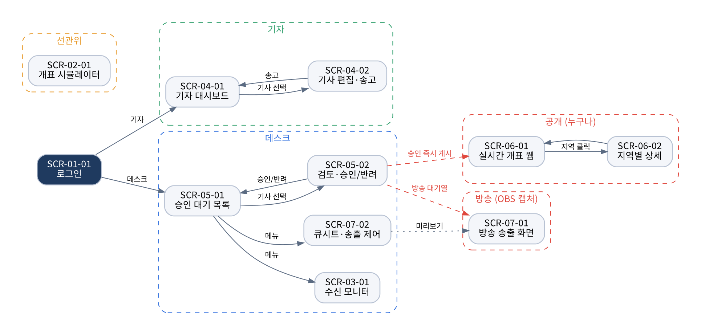</p>
<p align="center"><sub>화면 흐름도</sub></p>

| 화면 ID | 화면명 | 사용자 | URL | 관련 기능 |
|---|---|---|---|---|
| SCR-01-01 | 로그인 | 기자·데스크 | /login | FN-01-01 FN-01-02 |
| SCR-02-01 | 선관위 개표 시뮬레이터 | 선관위 운영자(관리자 키) | nec:/admin | FN-02-04 |
| SCR-03-01 | 개표 수신 모니터 | 데스크 | /desk/sync | FN-03-03 |
| SCR-04-01 | 기자 대시보드 (내 기사) | 기자 | /reporter | FN-04-03 |
| SCR-04-02 | 기사 편집·송고 | 기자 | /reporter/articles/{id} | FN-04-04 FN-04-05 |
| SCR-05-01 | 데스크 승인 대기 목록 | 데스크 | /desk | FN-05-01 |
| SCR-05-02 | 기사 검토·승인/반려 | 데스크 | /desk/articles/{id} | FN-05-02 FN-05-03 |
| SCR-06-01 | 실시간 개표 웹 (메인) | 누구나 | / | FN-06-01 FN-06-02 FN-06-03 |
| SCR-06-02 | 지역별 상세 | 누구나 | /regions/{code} | FN-06-02 FN-06-03 |
| SCR-07-01 | 방송 송출 화면 (1920×1080) | OBS 캡처용 | /onair/screen | FN-07-03 FN-07-04 FN-07-05 FN-07-07 |
| SCR-07-02 | 큐시트·송출 제어 | 데스크 | /desk/onair | FN-07-01 FN-07-05 FN-07-07 FN-07-06 |

<details>
<summary><b>SCR-01-01 로그인 <sub>(기자·데스크 · /login)</sub></b></summary>

기자·데스크 공용 로그인. 역할에 따라 기자 화면 또는 데스크 화면으로 이동

- 관련 요구: NFR-02, REQ-01-01, REQ-01-02
- 관련 기능: FN-01-01, FN-01-02
- 사용 API: API-01-01, API-01-02, API-01-03
- 사용 테이블: TBL-01-01

<p align="center">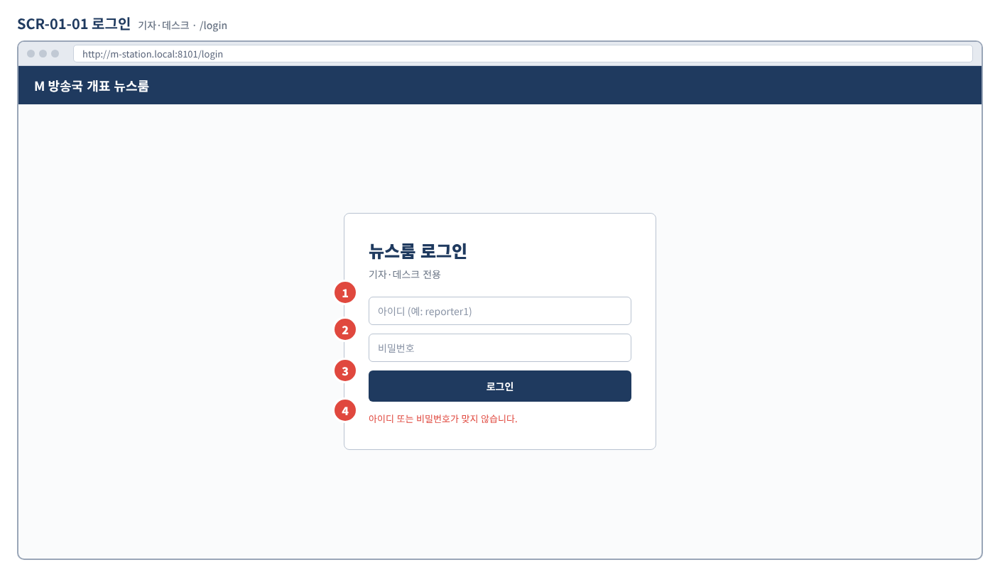</p>
<p align="center"><sub>SCR-01-01 로그인</sub></p>

| 번호 | 요소 | 설명 |
|---|---|---|
| 1 | 아이디 | reporter1~3, desk1~2 |
| 2 | 비밀번호 | 입력 후 Enter로 로그인 |
| 3 | 로그인 버튼 | 성공 시 기자→SCR-04-01, 데스크→SCR-05-01 |
| 4 | 오류 메시지 | 아이디·비밀번호 불일치 안내 |


</details>

<details>
<summary><b>SCR-02-01 선관위 개표 시뮬레이터 <sub>(선관위 운영자(관리자 키) · nec:/admin)</sub></b></summary>

개표 진행을 재현하는 선관위 쪽 관리 화면. 계정이 아니라 관리자 키로 접근

- 관련 요구: NFR-04, REQ-02-04, REQ-02-05
- 관련 기능: FN-02-04
- 사용 API: API-02-03, API-02-04
- 사용 테이블: TBL-02-04, TBL-02-05, TBL-02-07

<p align="center">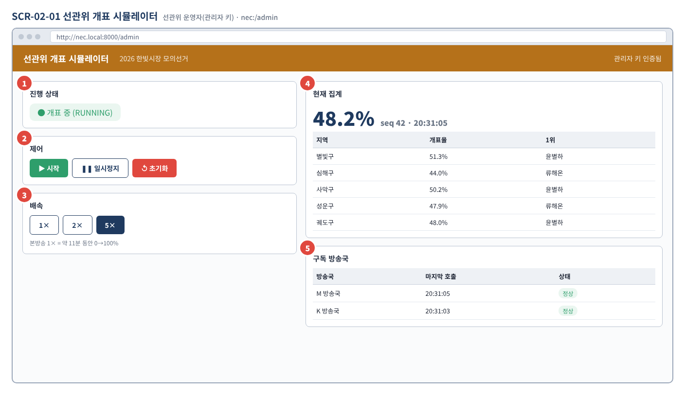</p>
<p align="center"><sub>SCR-02-01 선관위 개표 시뮬레이터</sub></p>

| 번호 | 요소 | 설명 |
|---|---|---|
| 1 | 진행 상태 | 대기 / 개표 중 / 일시정지 / 종료 |
| 2 | 제어 버튼 | 시작·일시정지·초기화 |
| 3 | 배속 | 1×·2×·5× (리허설은 5×, 본방송은 1×) |
| 4 | 현재 seq·개표율 | 전체 개표율과 마지막 순번 |
| 5 | 구독 방송국 | M·K 방송국의 마지막 호출 시각 |


</details>

<details>
<summary><b>SCR-03-01 개표 수신 모니터 <sub>(데스크 · /desk/sync)</sub></b></summary>

방송국 서버가 선관위 데이터를 잘 받고 있는지 확인

- 관련 요구: REQ-03-03
- 관련 기능: FN-03-03
- 사용 API: API-03-01, API-03-02
- 사용 테이블: TBL-03-05

<p align="center">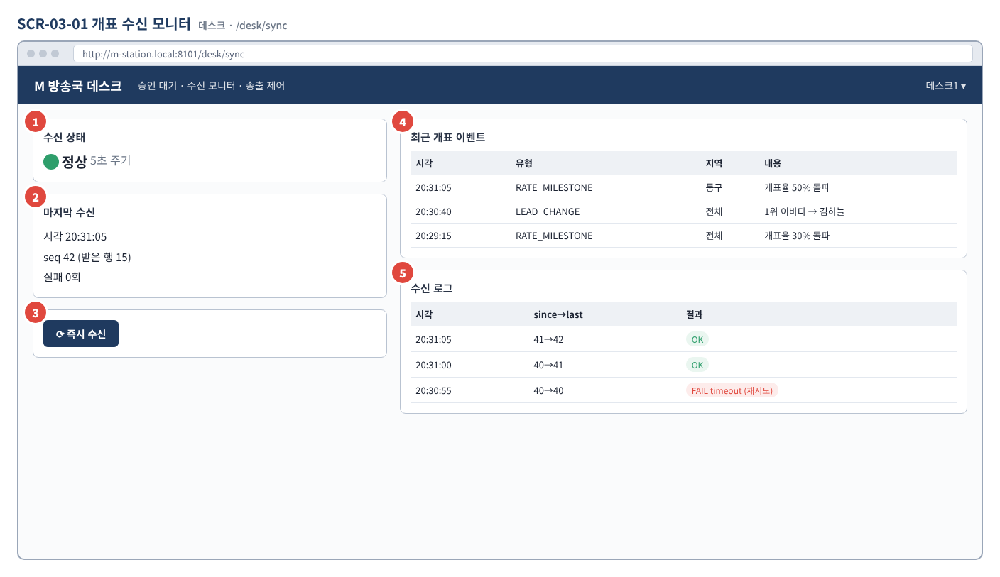</p>
<p align="center"><sub>SCR-03-01 개표 수신 모니터</sub></p>

| 번호 | 요소 | 설명 |
|---|---|---|
| 1 | 수신 상태 표시등 | 정상(초록)·지연(노랑)·실패(빨강) |
| 2 | 마지막 수신 | 시각·seq·받은 행 수 |
| 3 | 즉시 수신 | 5초를 기다리지 않고 바로 받아 오기 |
| 4 | 최근 이벤트 | 감지된 개표 이벤트 목록 |
| 5 | 수신 로그 | 실패 시 오류 메시지 |


</details>

<details>
<summary><b>SCR-04-01 기자 대시보드 (내 기사) <sub>(기자 · /reporter)</sub></b></summary>

나에게 배정된 자동 생성 초안과 반려 기사를 한눈에 보는 첫 화면

- 관련 요구: REQ-04-03, REQ-04-04
- 관련 기능: FN-04-03
- 사용 API: API-04-01, API-04-05
- 사용 테이블: TBL-04-01

<p align="center">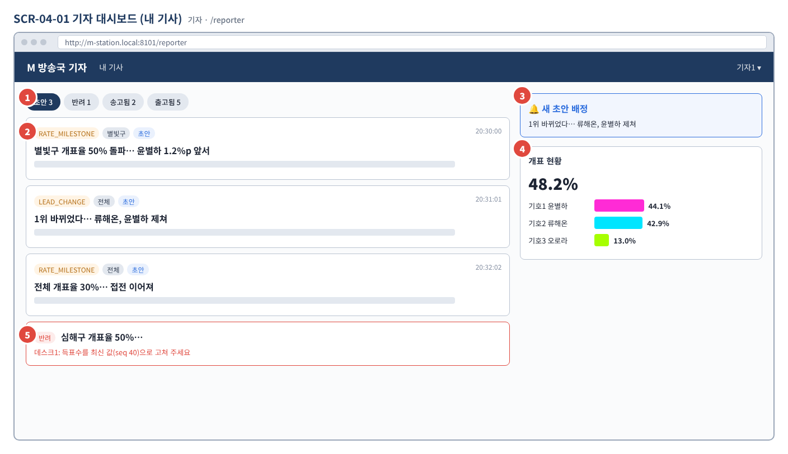</p>
<p align="center"><sub>SCR-04-01 기자 대시보드 (내 기사)</sub></p>

| 번호 | 요소 | 설명 |
|---|---|---|
| 1 | 상태 탭 | 초안·반려·송고됨·출고됨 |
| 2 | 기사 카드 | 이벤트 유형·지역·생성 시각·제목 |
| 3 | 새 초안 알림 | SSE로 새 배정 즉시 표시 |
| 4 | 미니 개표 현황 | 전체 개표율·1·2위 격차 |
| 5 | 반려 사유 | 데스크가 남긴 메모 |


</details>

<details>
<summary><b>SCR-04-02 기사 편집·송고 <sub>(기자 · /reporter/articles/{id})</sub></b></summary>

AI 초안을 사실 확인하며 고친 뒤 데스크로 송고

- 관련 요구: NFR-03, REQ-04-04
- 관련 기능: FN-04-04, FN-04-05
- 사용 API: API-04-02, API-04-03, API-04-04
- 사용 테이블: TBL-04-01

<p align="center">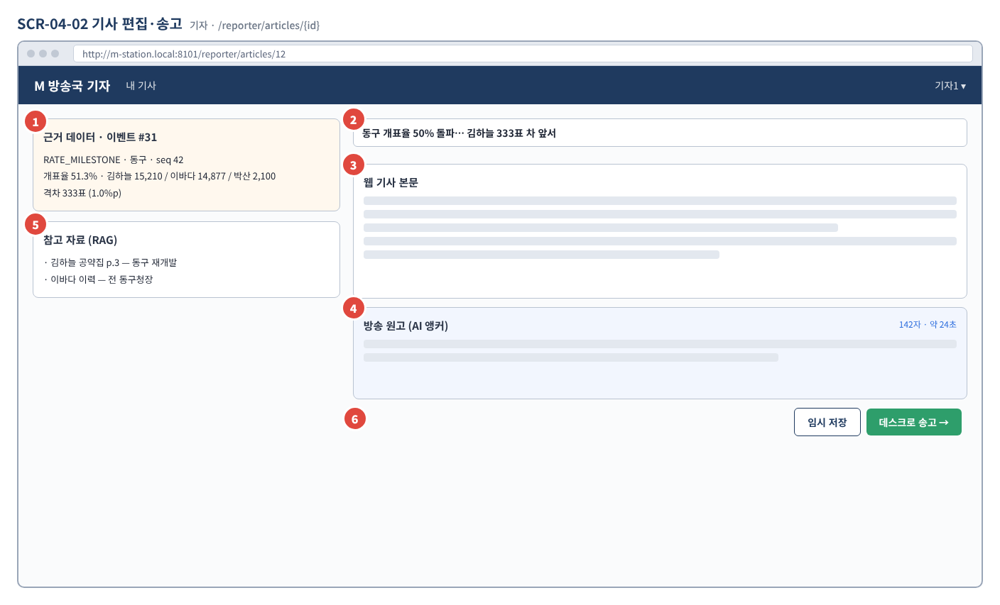</p>
<p align="center"><sub>SCR-04-02 기사 편집·송고</sub></p>

| 번호 | 요소 | 설명 |
|---|---|---|
| 1 | 근거 데이터 | 기사를 만든 이벤트와 개표 수치 (사실 확인용) |
| 2 | 제목 | 수정 가능 |
| 3 | 웹 기사 본문 | 수정 가능 |
| 4 | 방송 원고 | AI 앵커가 읽을 문장, 글자 수·예상 초 표시 |
| 5 | 참고 자료(RAG) | 초안에 쓰인 후보 이력·공약 출처 |
| 6 | 임시 저장 / 송고 | 송고하면 데스크 대기열로 |


</details>

<details>
<summary><b>SCR-05-01 데스크 승인 대기 목록 <sub>(데스크 · /desk)</sub></b></summary>

송고된 기사를 도착 순서대로 보는 데스크 첫 화면

- 관련 요구: REQ-05-01
- 관련 기능: FN-05-01
- 사용 API: API-04-05, API-05-01
- 사용 테이블: TBL-04-01

<p align="center">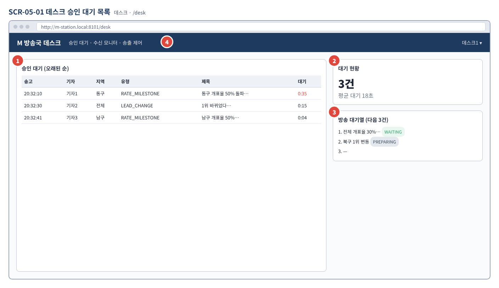</p>
<p align="center"><sub>SCR-05-01 데스크 승인 대기 목록</sub></p>

| 번호 | 요소 | 설명 |
|---|---|---|
| 1 | 대기 목록 | 송고 시각·기자·지역·제목, 오래된 순 |
| 2 | 대기 건수·평균 대기 시간 | 적체 확인 |
| 3 | 방송 대기열 미리보기 | 다음에 읽힐 기사 3건 |
| 4 | 상단 메뉴 | 승인 대기·수신 모니터·송출 제어 |


</details>

<details>
<summary><b>SCR-05-02 기사 검토·승인/반려 <sub>(데스크 · /desk/articles/{id})</sub></b></summary>

기사와 근거 데이터를 나란히 보고 승인 또는 반려

- 관련 요구: NFR-01, NFR-03, REQ-05-02, REQ-05-03, REQ-05-04
- 관련 기능: FN-05-02, FN-05-03
- 사용 API: API-05-02, API-05-03
- 사용 테이블: TBL-04-01, TBL-05-01, TBL-07-02, TBL-07-04

<p align="center">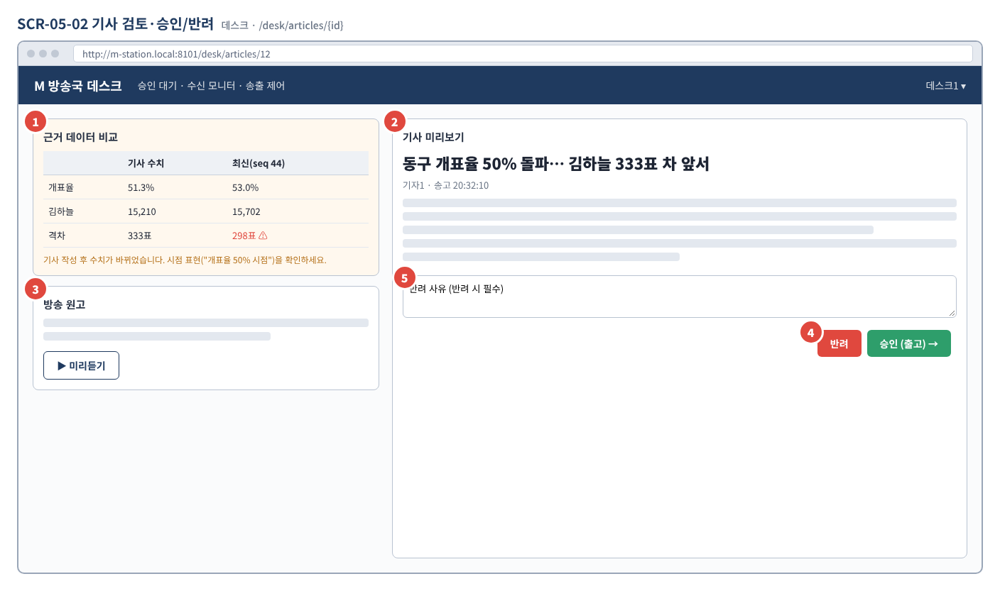</p>
<p align="center"><sub>SCR-05-02 기사 검토·승인/반려</sub></p>

| 번호 | 요소 | 설명 |
|---|---|---|
| 1 | 근거 데이터 | 이벤트·최신 개표 수치 비교 (기사 숫자와 다르면 경고) |
| 2 | 기사 미리보기 | 웹에 나갈 모습 |
| 3 | 방송 원고 미리듣기 | TTS 미리듣기(선택) |
| 4 | 승인(출고) | 웹 게시 + 방송 대기열 등록 |
| 5 | 반려 | 사유 입력 필수 |


</details>

<details>
<summary><b>SCR-06-01 실시간 개표 웹 (메인) <sub>(누구나 · /)</sub></b></summary>

개표 현황·지역 지도·실시간 기사를 보여 주는 공개 웹페이지

- 관련 요구: NFR-05, REQ-06-01, REQ-06-02, REQ-06-03, REQ-06-04
- 관련 기능: FN-06-01, FN-06-02, FN-06-03
- 사용 API: API-06-01, API-06-02, API-06-03, API-06-04
- 사용 테이블: TBL-03-01, TBL-03-02, TBL-03-03, TBL-04-01

<p align="center">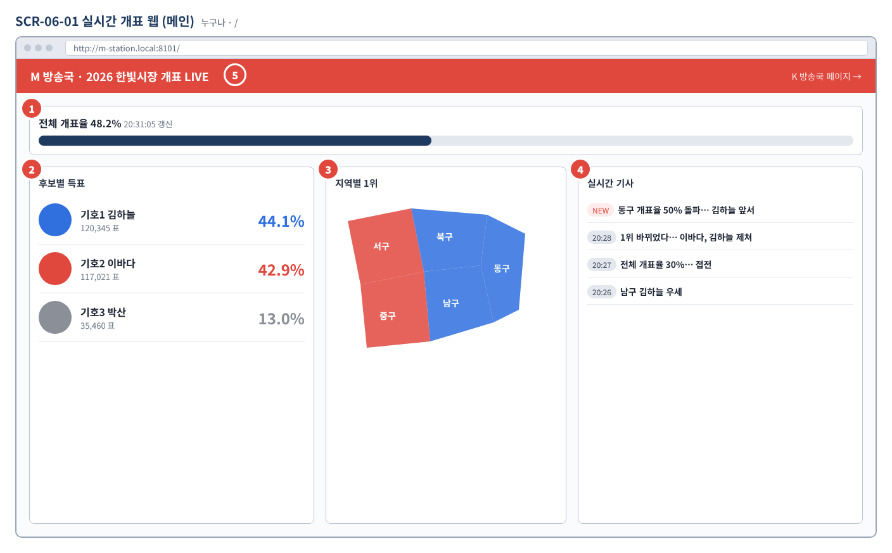</p>
<p align="center"><sub>SCR-06-01 실시간 개표 웹 (메인)</sub></p>

| 번호 | 요소 | 설명 |
|---|---|---|
| 1 | 전체 개표율 | 진행 막대와 갱신 시각 |
| 2 | 후보별 득표 | 득표수·득표율·순위, 당선 표시 |
| 3 | 지역 지도 | 구별 1위 후보 색, 누르면 SCR-06-02 |
| 4 | 실시간 기사 | 승인 기사가 맨 위에 추가 |
| 5 | 방송국 표시 | M 방송국 / K 방송국 |


</details>

<details>
<summary><b>SCR-06-02 지역별 상세 <sub>(누구나 · /regions/{code})</sub></b></summary>

선택한 구의 개표율·후보별 득표 차트와 그 지역 기사

- 관련 요구: REQ-06-02, REQ-06-03
- 관련 기능: FN-06-02, FN-06-03
- 사용 API: API-06-02, API-06-03, API-06-04
- 사용 테이블: TBL-03-02, TBL-03-03, TBL-04-01

<p align="center">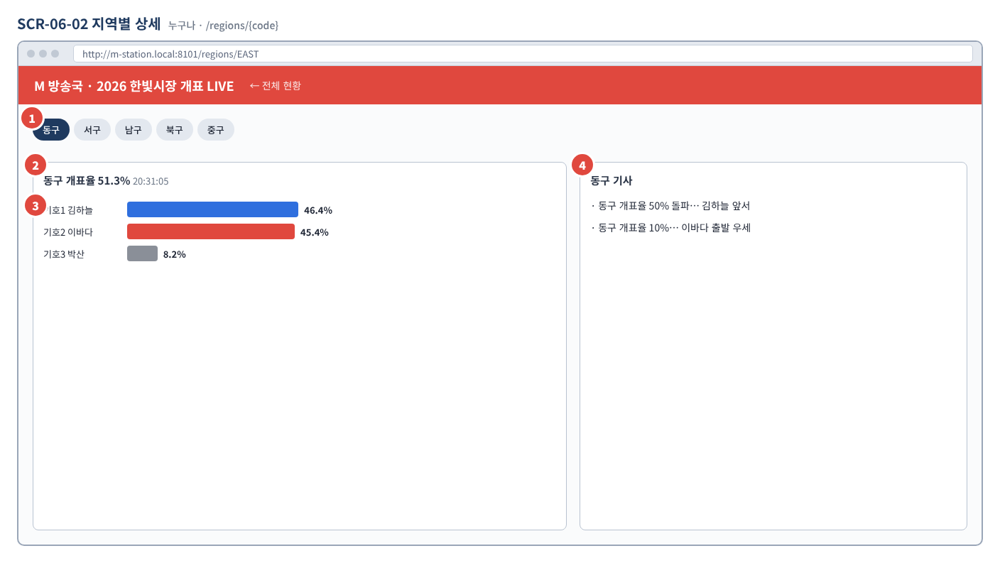</p>
<p align="center"><sub>SCR-06-02 지역별 상세</sub></p>

| 번호 | 요소 | 설명 |
|---|---|---|
| 1 | 지역 선택 | 5개 구 탭 |
| 2 | 지역 개표율 | 구 개표율과 갱신 시각 |
| 3 | 후보별 막대 차트 | 득표율 비교 (B-roll과 같은 차트) |
| 4 | 지역 기사 | 이 구 관련 승인 기사 |


</details>

<details>
<summary><b>SCR-07-01 방송 송출 화면 (1920×1080) <sub>(OBS 캡처용 · /onair/screen)</sub></b></summary>

OBS가 캡처해 방송하는 화면. 영상·AI 앵커·지역 차트·자막을 자동 재생

- 관련 요구: NFR-01, NFR-05, REQ-07-01, REQ-07-02, REQ-07-03, REQ-07-04, REQ-07-06
- 관련 기능: FN-07-03, FN-07-04, FN-07-05, FN-07-07
- 사용 API: API-06-02, API-07-02, API-07-03, API-07-05
- 사용 테이블: TBL-03-03, TBL-03-04, TBL-07-01, TBL-07-02, TBL-07-03, TBL-07-04, TBL-07-06

<p align="center">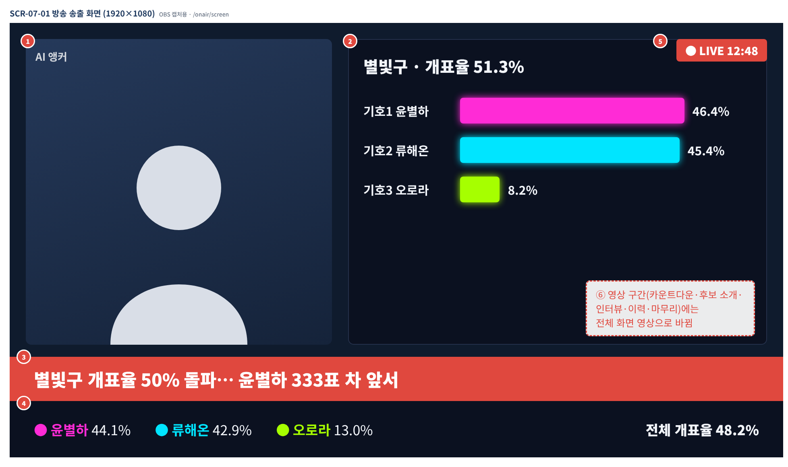</p>
<p align="center"><sub>SCR-07-01 방송 송출 화면 (1920×1080)</sub></p>

| 번호 | 요소 | 설명 |
|---|---|---|
| 1 | AI 앵커 영역 | 앵커 영상 + TTS 음성 |
| 2 | B-roll 차트 | 기사의 지역 차트 (지역 없으면 전체) |
| 3 | 하단 자막 | 방송 원고 요약 한 줄 |
| 4 | 득표 띠 | 후보별 득표율·전체 개표율 |
| 5 | LIVE·시계 | 남은 방송 시간 |
| 6 | 전체 화면 영상 | 카운트다운·후보 소개·인터뷰 등 영상 구간 |


</details>

<details>
<summary><b>SCR-07-02 큐시트·송출 제어 <sub>(데스크 · /desk/onair)</sub></b></summary>

20분 구성표 진행과 방송 대기열을 보고 송출을 제어

- 관련 요구: NFR-01, REQ-07-01, REQ-07-04, REQ-07-05, REQ-07-06
- 관련 기능: FN-07-01, FN-07-05, FN-07-07, FN-07-06
- 사용 API: API-07-01, API-07-02, API-07-04, API-07-05
- 사용 테이블: TBL-03-04, TBL-07-01, TBL-07-02, TBL-07-03, TBL-07-04, TBL-07-05, TBL-07-06

<p align="center">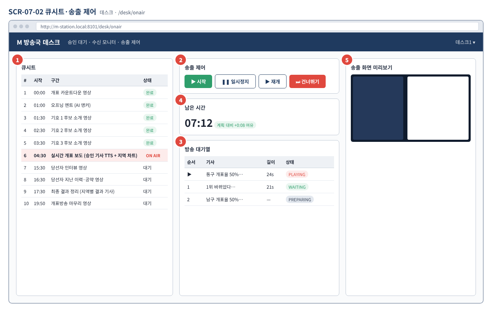</p>
<p align="center"><sub>SCR-07-02 큐시트·송출 제어</sub></p>

| 번호 | 요소 | 설명 |
|---|---|---|
| 1 | 큐시트 진행 | 10개 구간, 현재 구간 강조 |
| 2 | 제어 버튼 | 시작·일시정지·재개·건너뛰기 |
| 3 | 방송 대기열 | 승인 기사 TTS 순서·길이·상태 |
| 4 | 남은 시간 | 계획 대비 지연·여유 |
| 5 | 송출 화면 미리보기 | SCR-07-01 축소 화면 |


</details>

<details>
<summary><b>✅ 테스트케이스 — 1차 확인 (화면 테스트 9개)</b></summary>

화면 요소가 설계대로 보이고 움직이는지 사람이 직접 눌러 보며 확인합니다. 단계: 1 선관위 서버 · 2 방송국 수신·웹 · 3 기사 흐름 · 4 송출 · 5 마무리

| 번호 | 단계 | 확인할 것 | 절차 | 기대 결과 | 근거 | 방식 |
|---|---|---|---|---|---|---|
| TC-UI-01 | 2 | 로그인 화면 | 틀린 비밀번호, 기자 계정, 데스크 계정으로 차례로 로그인한다. | 틀리면 오류 문구, 기자는 SCR-04-01, 데스크는 SCR-05-01로 이동한다. | SCR-01-01 | 수동 |
| TC-UI-02 | 1 | 개표 시뮬레이터 | 시작 · 일시정지 · 5배속 · 초기화 버튼을 차례로 누른다. | 상태·배속·seq 표시가 바로 바뀌고, 초기화하면 개표율 0%, seq 0으로 돌아간다. | SCR-02-01, REQ-02-04 | 수동 |
| TC-UI-03 | 2 | 수신 모니터 | 선관위 서버를 30초 끈 뒤 다시 켠다. | 끄는 동안 실패 횟수가 늘고 빨간 표시, 다시 켜면 자동으로 정상 표시로 돌아온다. | SCR-03-01, REQ-03-03 | 수동 |
| TC-UI-04 | 3 | 기자 화면 | 새 초안 배정을 기다린 뒤 열어 수정·임시 저장, 다시 열기, 송고. | 새로고침 없이 새 초안 알림이 뜨고, 임시 저장 내용이 유지되며, 송고 뒤에는 수정 버튼이 잠긴다. | SCR-04-01, SCR-04-02 | 수동 |
| TC-UI-05 | 3 | 데스크 화면 | 기사 3건을 서로 다른 시각에 송고하고, 반려 사유 칸을 비운 채 반려를 눌러 본다. | 도착 순으로 정렬되고, 사유가 비어 있으면 반려 버튼이 눌리지 않는다. 승인한 기사는 목록에서 사라진다. | SCR-05-01, SCR-05-02, REQ-05-01 | 수동 |
| TC-UI-06 | 2 | 실시간 개표 웹 | 개표가 진행되는 동안 웹을 켜 둔다. | 새로고침 없이 숫자가 바뀌고, 후보 막대는 네온색, 득표율 글자는 진한색이라 잘 읽힌다. 최신 기사가 맨 위에 온다. | SCR-06-01, REQ-06-01 | 수동 |
| TC-UI-07 | 2 | 지역별 상세 | 지도에서 별빛구·심해구·사막구·성운구·궤도구를 하나씩 누른다. | 5개 구 모두 상세 차트로 이동하고, 1위 후보 색이 지도와 같다. | SCR-06-02, REQ-06-02 | 수동 |
| TC-UI-08 | 4 | 송출 화면 | 기사 낭독 중, 영상 구간(후보 소개) 중 화면을 본다. | 낭독 중에는 그 기사 지역 차트(B-roll)가, 영상 구간에는 전체 화면 영상이 나온다. 하단 득표 띠가 계속 갱신된다. | SCR-07-01, REQ-07-03 | 수동 |
| TC-UI-09 | 4 | 큐시트·송출 제어 | 시작 · 일시정지 · 건너뛰기를 누르고, 영상 파일 하나를 일부러 지운다. | 송출 화면에 바로 반영되고, 없는 영상 파일은 경고로 표시된다. | SCR-07-02, REQ-07-05 | 수동 |


</details>


</details>

<details>
<summary><b>05 · DB설계서 — ERD와 테이블 23개</b></summary>

📄 원본: [Google Docs](https://docs.google.com/document/d/120Toh3CB8oV5_14BBJvQavhwhuzn6it_1qkno5Y78TI/edit) · [Word 파일](docs/05_DB설계서.docx)

| DB | 인스턴스 | 테이블 | 설명 |
|---|---|---|---|
| nec_db (선관위) | 1개 | TBL-02-01~07 | 선거 원천 데이터·개표 스냅숏 |
| station_db (방송국) | 2개 (M, K) | TBL-01·03·04·05·07 | 같은 구조를 방송국마다 따로 |

<p align="center">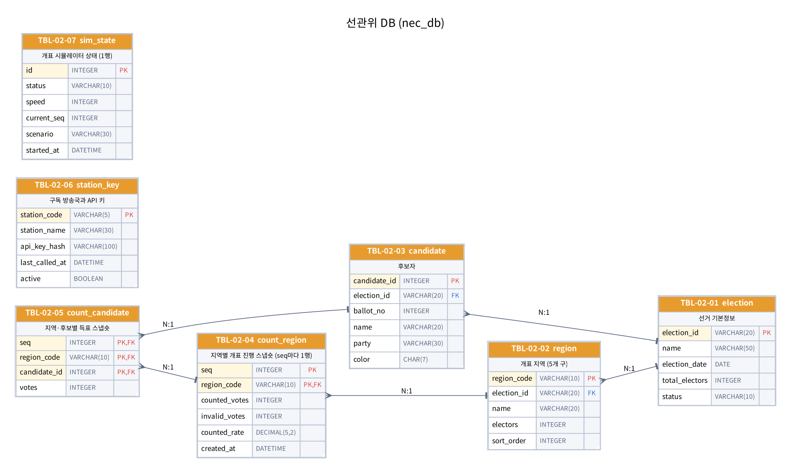</p>
<p align="center"><sub>선관위 DB ERD</sub></p>

<p align="center">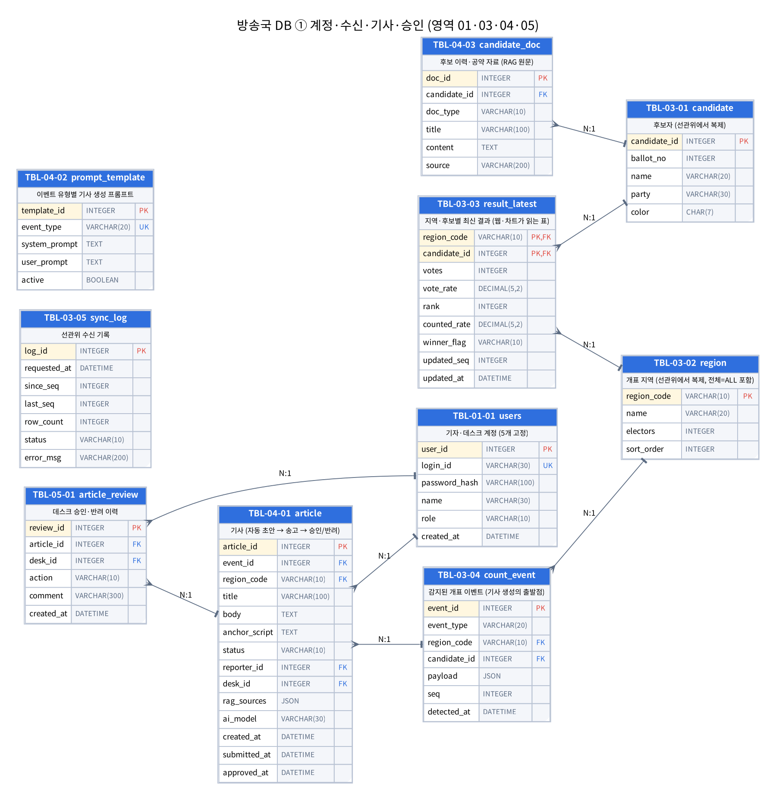</p>
<p align="center"><sub>방송국 DB ① 계정·수신·기사·승인</sub></p>

<p align="center">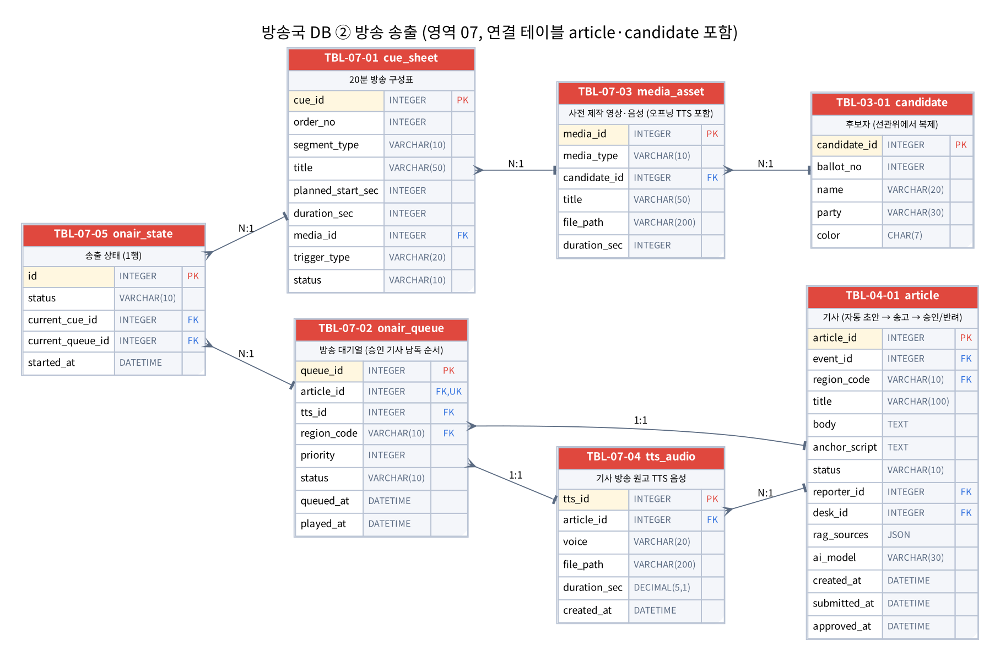</p>
<p align="center"><sub>방송국 DB ② 방송 송출</sub></p>

<details>
<summary><b>방송국 DB 전체 ERD</b></summary>

<p align="center">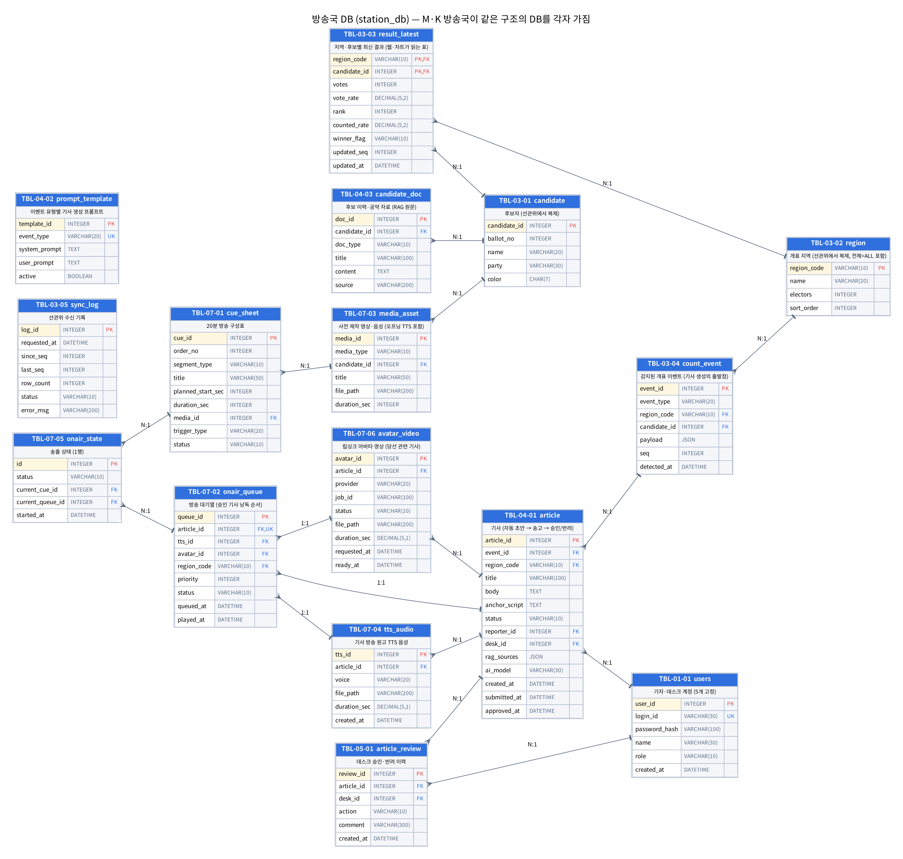</p>
<p align="center"><sub>방송국 DB 전체</sub></p>


</details>

### 테이블 목록
| 테이블 ID | DB | 테이블명 | 설명 | 사용 기능 |
|---|---|---|---|---|
| TBL-01-01 | 방송국 | users | 기자·데스크 계정 (5개 고정) | FN-01-01 FN-01-02 FN-04-02 |
| TBL-02-01 | 선관위 | election | 선거 기본정보 | FN-02-01 |
| TBL-02-02 | 선관위 | region | 개표 지역 (5개 구) | FN-02-01 |
| TBL-02-03 | 선관위 | candidate | 후보자 | FN-02-01 |
| TBL-02-04 | 선관위 | count_region | 지역별 개표 진행 스냅숏 (seq마다 1행) | FN-02-02 FN-02-04 |
| TBL-02-05 | 선관위 | count_candidate | 지역·후보별 득표 스냅숏 | FN-02-02 FN-02-04 |
| TBL-02-06 | 선관위 | station_key | 구독 방송국과 API 키 | FN-02-03 |
| TBL-02-07 | 선관위 | sim_state | 개표 시뮬레이터 상태 (1행) | FN-02-04 |
| TBL-03-01 | 방송국 | candidate | 후보자 (선관위에서 복제) | FN-03-01 FN-06-01 |
| TBL-03-02 | 방송국 | region | 개표 지역 (선관위에서 복제, 전체=ALL 포함) | FN-03-01 FN-06-02 |
| TBL-03-03 | 방송국 | result_latest | 지역·후보별 최신 결과 (웹·차트가 읽는 표) | FN-03-01 FN-03-02 FN-06-01 FN-06-02 FN-07-04 |
| TBL-03-04 | 방송국 | count_event | 감지된 개표 이벤트 (기사 생성의 출발점) | FN-03-02 FN-04-01 FN-07-05 |
| TBL-03-05 | 방송국 | sync_log | 선관위 수신 기록 | FN-03-01 FN-03-03 |
| TBL-04-01 | 방송국 | article | 기사 (자동 초안 → 송고 → 승인/반려) | FN-04-01 FN-04-02 FN-04-03 FN-04-04 FN-04-05 FN-05-01 FN-05-02 FN-05-03 FN-06-03 |
| TBL-04-02 | 방송국 | prompt_template | 이벤트 유형별 기사 생성 프롬프트 | FN-04-01 |
| TBL-04-03 | 방송국 | candidate_doc | 후보 이력·공약 자료 (RAG 원문) | FN-04-01 |
| TBL-05-01 | 방송국 | article_review | 데스크 승인·반려 이력 | FN-05-02 FN-05-03 |
| TBL-07-01 | 방송국 | cue_sheet | 20분 방송 구성표 | FN-07-01 FN-07-03 FN-07-05 |
| TBL-07-02 | 방송국 | onair_queue | 방송 대기열 (승인 기사 낭독 순서) | FN-05-02 FN-07-03 FN-07-07 |
| TBL-07-03 | 방송국 | media_asset | 사전 제작 영상·음성 (오프닝 TTS 포함) | FN-07-01 FN-07-05 |
| TBL-07-04 | 방송국 | tts_audio | 기사 방송 원고 TTS 음성 | FN-05-02 FN-07-02 FN-07-07 |
| TBL-07-05 | 방송국 | onair_state | 송출 상태 (1행) | FN-07-06 |
| TBL-07-06 | 방송국 | avatar_video | 립싱크 아바타 영상 (당선 관련 기사) | FN-07-07 |

<details>
<summary><b>TBL-01-01 <code>users</code> — 기자·데스크 계정 (5개 고정)</b></summary>

DB: 방송국 · 사용 기능: FN-01-01, FN-01-02, FN-04-02 · 사용 API: API-01-01, API-01-02, API-01-03

| 컬럼 | 타입 | 키 | NULL | 설명 |
|---|---|---|---|---|
| `user_id` | INTEGER | PK | N | 사용자 번호 |
| `login_id` | VARCHAR(30) | UK | N | reporter1 / desk1 |
| `password_hash` | VARCHAR(100) |  | N | bcrypt 해시 |
| `name` | VARCHAR(30) |  | N | 표시 이름 |
| `role` | VARCHAR(10) |  | N | REPORTER / DESK |
| `created_at` | DATETIME |  | N | 생성 시각 |


</details>

<details>
<summary><b>TBL-02-01 <code>election</code> — 선거 기본정보</b></summary>

DB: 선관위 · 사용 기능: FN-02-01 · 사용 API: API-02-01

| 컬럼 | 타입 | 키 | NULL | 설명 |
|---|---|---|---|---|
| `election_id` | VARCHAR(20) | PK | N | 예: HANBIT-2026 |
| `name` | VARCHAR(50) |  | N | 선거명 |
| `election_date` | DATE |  | N | 선거일 |
| `total_electors` | INTEGER |  | N | 전체 선거인 수 |
| `status` | VARCHAR(10) |  | N | READY / COUNTING / CLOSED |


</details>

<details>
<summary><b>TBL-02-02 <code>region</code> — 개표 지역 (5개 구)</b></summary>

DB: 선관위 · 사용 기능: FN-02-01 · 사용 API: API-02-01

| 컬럼 | 타입 | 키 | NULL | 설명 |
|---|---|---|---|---|
| `region_code` | VARCHAR(10) | PK | N | STAR / DEEP … |
| `election_id` | VARCHAR(20) | FK | N | → election |
| `name` | VARCHAR(20) |  | N | 별빛구 등 |
| `electors` | INTEGER |  | N | 지역 선거인 수 |
| `sort_order` | INTEGER |  | N | 표시 순서 |


</details>

<details>
<summary><b>TBL-02-03 <code>candidate</code> — 후보자</b></summary>

DB: 선관위 · 사용 기능: FN-02-01 · 사용 API: API-02-01

| 컬럼 | 타입 | 키 | NULL | 설명 |
|---|---|---|---|---|
| `candidate_id` | INTEGER | PK | N | 후보 번호 |
| `election_id` | VARCHAR(20) | FK | N | → election |
| `ballot_no` | INTEGER |  | N | 기호 |
| `name` | VARCHAR(20) |  | N | 이름 |
| `party` | VARCHAR(30) |  | Y | 정당 |
| `color` | CHAR(7) |  | N | 차트 색 (#RRGGBB) |


</details>

<details>
<summary><b>TBL-02-04 <code>count_region</code> — 지역별 개표 진행 스냅숏 (seq마다 1행)</b></summary>

DB: 선관위 · 사용 기능: FN-02-02, FN-02-04 · 사용 API: API-02-02

| 컬럼 | 타입 | 키 | NULL | 설명 |
|---|---|---|---|---|
| `seq` | INTEGER | PK | N | 갱신 순번 (전체 공통 증가) |
| `region_code` | VARCHAR(10) | PK,FK | N | → region |
| `counted_votes` | INTEGER |  | N | 개표된 투표수 |
| `invalid_votes` | INTEGER |  | N | 무효표 |
| `counted_rate` | DECIMAL(5,2) |  | N | 지역 개표율(%) |
| `created_at` | DATETIME |  | N | 집계 시각 |


</details>

<details>
<summary><b>TBL-02-05 <code>count_candidate</code> — 지역·후보별 득표 스냅숏</b></summary>

DB: 선관위 · 사용 기능: FN-02-02, FN-02-04 · 사용 API: API-02-02

| 컬럼 | 타입 | 키 | NULL | 설명 |
|---|---|---|---|---|
| `seq` | INTEGER | PK,FK | N | → count_region.seq |
| `region_code` | VARCHAR(10) | PK,FK | N | → count_region |
| `candidate_id` | INTEGER | PK,FK | N | → candidate |
| `votes` | INTEGER |  | N | 누적 득표수 |


</details>

<details>
<summary><b>TBL-02-06 <code>station_key</code> — 구독 방송국과 API 키</b></summary>

DB: 선관위 · 사용 기능: FN-02-03 · 사용 API: API-02-02, API-02-04

| 컬럼 | 타입 | 키 | NULL | 설명 |
|---|---|---|---|---|
| `station_code` | VARCHAR(5) | PK | N | M / K |
| `station_name` | VARCHAR(30) |  | N | M 방송국 |
| `api_key_hash` | VARCHAR(100) |  | N | API 키 해시 |
| `last_called_at` | DATETIME |  | Y | 마지막 호출 시각 |
| `active` | BOOLEAN |  | N | 사용 여부 |


</details>

<details>
<summary><b>TBL-02-07 <code>sim_state</code> — 개표 시뮬레이터 상태 (1행)</b></summary>

DB: 선관위 · 사용 기능: FN-02-04 · 사용 API: API-02-03, API-02-04

| 컬럼 | 타입 | 키 | NULL | 설명 |
|---|---|---|---|---|
| `id` | INTEGER | PK | N | 항상 1 |
| `status` | VARCHAR(10) |  | N | READY / RUNNING / PAUSED / DONE |
| `speed` | INTEGER |  | N | 배속 1·2·5 |
| `current_seq` | INTEGER |  | N | 마지막 발행 seq |
| `scenario` | VARCHAR(30) |  | N | 시나리오 파일명 |
| `started_at` | DATETIME |  | Y | 시작 시각 |


</details>

<details>
<summary><b>TBL-03-01 <code>candidate</code> — 후보자 (선관위에서 복제)</b></summary>

DB: 방송국 · 사용 기능: FN-03-01, FN-06-01 · 사용 API: API-06-01

| 컬럼 | 타입 | 키 | NULL | 설명 |
|---|---|---|---|---|
| `candidate_id` | INTEGER | PK | N | 선관위 후보 번호 |
| `ballot_no` | INTEGER |  | N | 기호 |
| `name` | VARCHAR(20) |  | N | 이름 |
| `party` | VARCHAR(30) |  | Y | 정당 |
| `color` | CHAR(7) |  | N | 차트 색 |


</details>

<details>
<summary><b>TBL-03-02 <code>region</code> — 개표 지역 (선관위에서 복제, 전체=ALL 포함)</b></summary>

DB: 방송국 · 사용 기능: FN-03-01, FN-06-02 · 사용 API: API-06-01, API-06-02

| 컬럼 | 타입 | 키 | NULL | 설명 |
|---|---|---|---|---|
| `region_code` | VARCHAR(10) | PK | N | ALL / STAR … |
| `name` | VARCHAR(20) |  | N | 전체 / 별빛구 |
| `electors` | INTEGER |  | N | 선거인 수 |
| `sort_order` | INTEGER |  | N | 표시 순서 |


</details>

<details>
<summary><b>TBL-03-03 <code>result_latest</code> — 지역·후보별 최신 결과 (웹·차트가 읽는 표)</b></summary>

DB: 방송국 · 사용 기능: FN-03-01, FN-03-02, FN-06-01, FN-06-02, FN-07-04 · 사용 API: API-03-02, API-06-01, API-06-02, API-06-04

| 컬럼 | 타입 | 키 | NULL | 설명 |
|---|---|---|---|---|
| `region_code` | VARCHAR(10) | PK,FK | N | → region |
| `candidate_id` | INTEGER | PK,FK | N | → candidate |
| `votes` | INTEGER |  | N | 득표수 |
| `vote_rate` | DECIMAL(5,2) |  | N | 득표율(%) |
| `rank` | INTEGER |  | N | 지역 내 순위 |
| `counted_rate` | DECIMAL(5,2) |  | N | 지역 개표율(%) |
| `winner_flag` | VARCHAR(10) |  | Y | LIKELY / SURE / ELECTED |
| `updated_seq` | INTEGER |  | N | 반영한 seq |
| `updated_at` | DATETIME |  | N | 반영 시각 |


</details>

<details>
<summary><b>TBL-03-04 <code>count_event</code> — 감지된 개표 이벤트 (기사 생성의 출발점)</b></summary>

DB: 방송국 · 사용 기능: FN-03-02, FN-04-01, FN-07-05 · 사용 API: API-03-01, API-04-02

| 컬럼 | 타입 | 키 | NULL | 설명 |
|---|---|---|---|---|
| `event_id` | INTEGER | PK | N | 이벤트 번호 |
| `event_type` | VARCHAR(20) |  | N | RATE_MILESTONE / LEAD_CHANGE / WIN_LIKELY / WIN_SURE / ELECTED |
| `region_code` | VARCHAR(10) | FK | N | → region (전체=ALL) |
| `candidate_id` | INTEGER | FK | Y | 관련 후보 |
| `payload` | JSON |  | N | 당시 수치 (개표율·득표·격차) |
| `seq` | INTEGER |  | N | 감지 seq |
| `detected_at` | DATETIME |  | N | 감지 시각 |


</details>

<details>
<summary><b>TBL-03-05 <code>sync_log</code> — 선관위 수신 기록</b></summary>

DB: 방송국 · 사용 기능: FN-03-01, FN-03-03 · 사용 API: API-03-01, API-03-02

| 컬럼 | 타입 | 키 | NULL | 설명 |
|---|---|---|---|---|
| `log_id` | INTEGER | PK | N | 로그 번호 |
| `requested_at` | DATETIME |  | N | 요청 시각 |
| `since_seq` | INTEGER |  | N | 요청 seq |
| `last_seq` | INTEGER |  | Y | 받은 마지막 seq |
| `row_count` | INTEGER |  | N | 받은 행 수 |
| `status` | VARCHAR(10) |  | N | OK / FAIL |
| `error_msg` | VARCHAR(200) |  | Y | 오류 내용 |


</details>

<details>
<summary><b>TBL-04-01 <code>article</code> — 기사 (자동 초안 → 송고 → 승인/반려)</b></summary>

DB: 방송국 · 사용 기능: FN-04-01, FN-04-02, FN-04-03, FN-04-04, FN-04-05, FN-05-01, FN-05-02, FN-05-03, FN-06-03 · 사용 API: API-04-01, API-04-02, API-04-03, API-04-04, API-04-05, API-05-01, API-05-02, API-05-03, API-06-03, API-06-04

| 컬럼 | 타입 | 키 | NULL | 설명 |
|---|---|---|---|---|
| `article_id` | INTEGER | PK | N | 기사 번호 |
| `event_id` | INTEGER | FK | N | → count_event |
| `region_code` | VARCHAR(10) | FK | N | → region (B-roll 차트 지역) |
| `title` | VARCHAR(100) |  | N | 제목 |
| `body` | TEXT |  | N | 웹 기사 본문 |
| `anchor_script` | TEXT |  | N | 방송 원고 (TTS용) |
| `status` | VARCHAR(10) |  | N | DRAFT / SUBMITTED / REJECTED / APPROVED |
| `reporter_id` | INTEGER | FK | N | → users (담당 기자) |
| `desk_id` | INTEGER | FK | Y | → users (승인 데스크) |
| `rag_sources` | JSON |  | Y | 참고한 후보 자료 id |
| `ai_model` | VARCHAR(30) |  | N | 생성 모델명 |
| `created_at` | DATETIME |  | N | 생성 |
| `submitted_at` | DATETIME |  | Y | 송고 |
| `approved_at` | DATETIME |  | Y | 승인(=웹 게시) |


</details>

<details>
<summary><b>TBL-04-02 <code>prompt_template</code> — 이벤트 유형별 기사 생성 프롬프트</b></summary>

DB: 방송국 · 사용 기능: FN-04-01 · 사용 API: —

| 컬럼 | 타입 | 키 | NULL | 설명 |
|---|---|---|---|---|
| `template_id` | INTEGER | PK | N | 번호 |
| `event_type` | VARCHAR(20) | UK | N | 이벤트 유형 |
| `system_prompt` | TEXT |  | N | 기자 역할·문체 지침 |
| `user_prompt` | TEXT |  | N | 수치가 들어갈 틀 |
| `active` | BOOLEAN |  | N | 사용 여부 |


</details>

<details>
<summary><b>TBL-04-03 <code>candidate_doc</code> — 후보 이력·공약 자료 (RAG 원문)</b></summary>

DB: 방송국 · 사용 기능: FN-04-01 · 사용 API: —

| 컬럼 | 타입 | 키 | NULL | 설명 |
|---|---|---|---|---|
| `doc_id` | INTEGER | PK | N | 자료 번호 |
| `candidate_id` | INTEGER | FK | N | → candidate |
| `doc_type` | VARCHAR(10) |  | N | PROFILE(이력) / PLEDGE(공약) |
| `title` | VARCHAR(100) |  | N | 자료 제목 |
| `content` | TEXT |  | N | 본문 (벡터DB에 임베딩) |
| `source` | VARCHAR(200) |  | Y | 출처 |


</details>

<details>
<summary><b>TBL-05-01 <code>article_review</code> — 데스크 승인·반려 이력</b></summary>

DB: 방송국 · 사용 기능: FN-05-02, FN-05-03 · 사용 API: API-04-02, API-04-05, API-05-02, API-05-03

| 컬럼 | 타입 | 키 | NULL | 설명 |
|---|---|---|---|---|
| `review_id` | INTEGER | PK | N | 번호 |
| `article_id` | INTEGER | FK | N | → article |
| `desk_id` | INTEGER | FK | N | → users |
| `action` | VARCHAR(10) |  | N | APPROVE / REJECT |
| `comment` | VARCHAR(300) |  | Y | 반려 사유·메모 |
| `created_at` | DATETIME |  | N | 처리 시각 |


</details>

<details>
<summary><b>TBL-07-01 <code>cue_sheet</code> — 20분 방송 구성표</b></summary>

DB: 방송국 · 사용 기능: FN-07-01, FN-07-03, FN-07-05 · 사용 API: API-07-01, API-07-02, API-07-04

| 컬럼 | 타입 | 키 | NULL | 설명 |
|---|---|---|---|---|
| `cue_id` | INTEGER | PK | N | 번호 |
| `order_no` | INTEGER |  | N | 순서 1~10 |
| `segment_type` | VARCHAR(10) |  | N | COUNTDOWN/ANCHOR/INTRO/LIVE/INTERVIEW/PROFILE/CLOSING |
| `title` | VARCHAR(50) |  | N | 구간 이름 |
| `planned_start_sec` | INTEGER |  | N | 계획 시작(초) |
| `duration_sec` | INTEGER |  | N | 길이(초) |
| `media_id` | INTEGER | FK | Y | → media_asset (영상 구간) |
| `trigger_type` | VARCHAR(20) |  | N | AUTO / ELECTED |
| `status` | VARCHAR(10) |  | N | READY / ON_AIR / DONE |


</details>

<details>
<summary><b>TBL-07-02 <code>onair_queue</code> — 방송 대기열 (승인 기사 낭독 순서)</b></summary>

DB: 방송국 · 사용 기능: FN-05-02, FN-07-03, FN-07-07 · 사용 API: API-05-02, API-07-02, API-07-03, API-07-05

| 컬럼 | 타입 | 키 | NULL | 설명 |
|---|---|---|---|---|
| `queue_id` | INTEGER | PK | N | 번호 |
| `article_id` | INTEGER | FK,UK | N | → article |
| `tts_id` | INTEGER | FK | Y | → tts_audio (생성 전 NULL) |
| `avatar_id` | INTEGER | FK | Y | → avatar_video (아바타 대상만) |
| `region_code` | VARCHAR(10) | FK | N | B-roll 지역 |
| `priority` | INTEGER |  | N | 1=당선 관련, 5=일반 |
| `status` | VARCHAR(10) |  | N | PREPARING / WAITING / PLAYING / DONE / SKIPPED |
| `queued_at` | DATETIME |  | N | 등록 |
| `played_at` | DATETIME |  | Y | 송출 |


</details>

<details>
<summary><b>TBL-07-03 <code>media_asset</code> — 사전 제작 영상·음성 (오프닝 TTS 포함)</b></summary>

DB: 방송국 · 사용 기능: FN-07-01, FN-07-05 · 사용 API: API-07-01, API-07-02

| 컬럼 | 타입 | 키 | NULL | 설명 |
|---|---|---|---|---|
| `media_id` | INTEGER | PK | N | 번호 |
| `media_type` | VARCHAR(10) |  | N | COUNTDOWN/OPENING/INTRO/INTERVIEW/PROFILE/CLOSING/ANCHOR_LOOP (OPENING·CLOSING은 립싱크 아바타) |
| `candidate_id` | INTEGER | FK | Y | → candidate (후보별 영상) |
| `title` | VARCHAR(50) |  | N | 영상 제목 |
| `file_path` | VARCHAR(200) |  | N | /static/media/…mp4 · mp3 |
| `duration_sec` | INTEGER |  | N | 길이(초) |


</details>

<details>
<summary><b>TBL-07-04 <code>tts_audio</code> — 기사 방송 원고 TTS 음성</b></summary>

DB: 방송국 · 사용 기능: FN-05-02, FN-07-02, FN-07-07 · 사용 API: API-05-02, API-07-02

| 컬럼 | 타입 | 키 | NULL | 설명 |
|---|---|---|---|---|
| `tts_id` | INTEGER | PK | N | 번호 |
| `article_id` | INTEGER | FK | N | → article |
| `voice` | VARCHAR(20) |  | N | 음성 이름 |
| `file_path` | VARCHAR(200) |  | N | /static/tts/….mp3 |
| `duration_sec` | DECIMAL(5,1) |  | N | 재생 길이 |
| `created_at` | DATETIME |  | N | 생성 시각 |


</details>

<details>
<summary><b>TBL-07-05 <code>onair_state</code> — 송출 상태 (1행)</b></summary>

DB: 방송국 · 사용 기능: FN-07-06 · 사용 API: API-07-04, API-07-05

| 컬럼 | 타입 | 키 | NULL | 설명 |
|---|---|---|---|---|
| `id` | INTEGER | PK | N | 항상 1 |
| `status` | VARCHAR(10) |  | N | STANDBY / ON_AIR / PAUSED / ENDED |
| `current_cue_id` | INTEGER | FK | Y | → cue_sheet |
| `current_queue_id` | INTEGER | FK | Y | → onair_queue |
| `started_at` | DATETIME |  | Y | 방송 시작 시각 |


</details>

<details>
<summary><b>TBL-07-06 <code>avatar_video</code> — 립싱크 아바타 영상 (당선 관련 기사)</b></summary>

DB: 방송국 · 사용 기능: FN-07-07 · 사용 API: API-07-02

| 컬럼 | 타입 | 키 | NULL | 설명 |
|---|---|---|---|---|
| `avatar_id` | INTEGER | PK | N | 번호 |
| `article_id` | INTEGER | FK | N | → article |
| `provider` | VARCHAR(20) |  | N | HEYGEN / RUNWAY 등 |
| `job_id` | VARCHAR(100) |  | Y | 외부 서비스 작업 번호 |
| `status` | VARCHAR(10) |  | N | REQUESTED / READY / FAILED / TIMEOUT |
| `file_path` | VARCHAR(200) |  | Y | /static/avatar/….mp4 |
| `duration_sec` | DECIMAL(5,1) |  | Y | 재생 길이 |
| `requested_at` | DATETIME |  | N | 요청 시각 |
| `ready_at` | DATETIME |  | Y | 준비 시각 |


</details>

<details>
<summary><b>✅ 테스트케이스 — 1차 확인 (데이터 테스트 7개)</b></summary>

표에 들어간 데이터의 개수·중복·연결이 맞는지 확인합니다. 단계: 1 선관위 서버 · 2 방송국 수신·웹 · 3 기사 흐름 · 4 송출 · 5 마무리

| 번호 | 단계 | 확인할 것 | 절차 | 기대 결과 | 근거 | 방식 |
|---|---|---|---|---|---|---|
| TC-DB-01 | 1 | 처음 넣는 데이터 (seed) | seed를 실행한 뒤 표마다 행 수를 센다. | 구 5행(STAR·DEEP·DUNE·NEBULA·ORBIT), 후보 3행(윤별하·류해온·오로라, 색 포함), 방송국 키 2행, 계정 5행. | TBL-02-02, TBL-02-03, TBL-02-06, TBL-01-01 | 자동 |
| TC-DB-02 | 1 | 개표 스냅숏 쌓기 | 시뮬레이터를 끝까지 돌린 뒤 count_region·count_candidate를 확인한다. | seq는 늘기만 하고 중복이 없다. 득표는 줄지 않고, 합계가 선거인 수를 넘지 않는다. | TBL-02-04, TBL-02-05 | 자동 |
| TC-DB-03 | 2 | 최신 결과 한 벌 | 수신을 몇 번 돌린 뒤 result_latest 행 수를 센다. | 구 5개 × 후보 3명 + 전체(ALL) 3명 = 18행이고, 값이 선관위 최신 seq와 같다. | TBL-03-03, FN-03-01, REQ-03-01 | 자동 |
| TC-DB-04 | 2 | 이벤트 중복 막기 | 같은 변경분을 두 번 수신한다. | count_event에 같은 (지역, 유형, 구간)은 1행만 있다. | TBL-03-04 | 자동 |
| TC-DB-05 | 3 | 검토 이력 | 기사 1건을 반려 → 다시 송고 → 승인한다. | article_review에 2행이 남고, 데스크·시각·결과·반려 사유가 모두 채워진다. | TBL-05-01, REQ-05-04 | 자동 |
| TC-DB-06 | 4 | 대기열 연결 | 기사 몇 건을 승인한 뒤 onair_queue·tts_audio를 확인한다. | 대기열은 승인 기사만 가리키고, tts_audio의 파일 경로에 실제 파일이 있다. | TBL-07-02, TBL-07-04 | 자동 |
| TC-DB-07 | 2 | 서버를 껐다 켜도 유지 | 기사·대기열이 있는 상태에서 방송국 서버를 껐다 켠다. | 기사·대기열·수신 seq가 그대로 남아 이어서 진행된다. | TBL-04-01, TBL-07-02 | 수동 |


</details>


</details>

<details>
<summary><b>06 · API명세서 — API 26개</b></summary>

📄 원본: [Google Docs](https://docs.google.com/document/d/1Ocz1CKh_Inwefhu0evptVir96jHCrhYiM74WLk-Ad4Y/edit) · [Word 파일](docs/06_API명세서.docx)

### 공통 규칙
| 항목 | 내용 |
|---|---|
| 주소 | 선관위 :8000 · M 방송국 :8101 · K 방송국 :8102 |
| 형식 | JSON (UTF-8), 실시간 알림은 SSE |
| 선관위 인증 | X-API-KEY (방송국), X-ADMIN-KEY (시뮬레이터) |
| 방송국 인증 | 세션 쿠키 · REPORTER / DESK / 공개 |
| 송출 화면 | 송출 PC에서 데스크 계정으로 로그인한 브라우저 |

### 오류 코드
| 코드 | 뜻 | 예 |
|---|---|---|
| 400 | 요청 형식 오류 | 사유 없는 반려 |
| 401 | 인증 없음 | 세션 만료 |
| 403 | 권한 없음 | 기자가 승인 호출 |
| 404 | 없음 | 없는 기사 |
| 409 | 상태 충돌 | 이미 승인된 기사 재승인 |
| 500 | 서버 오류 | LLM·TTS 실패 |

<p align="center">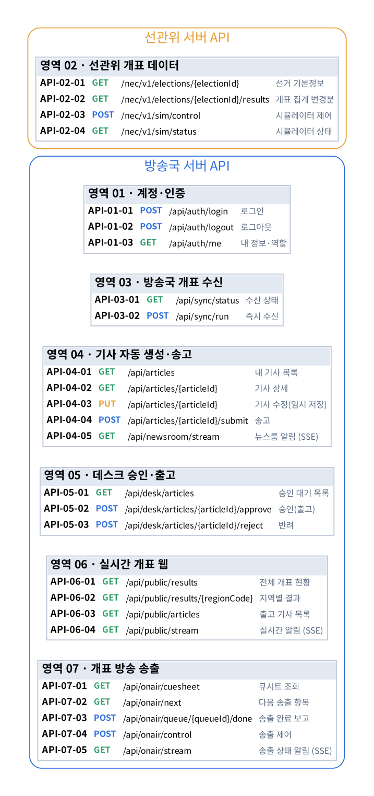</p>
<p align="center"><sub>API 지도</sub></p>

### API 목록
| API ID | 서버 | 메서드 | 경로 | 이름 | 권한 |
|---|---|---|---|---|---|
| API-01-01 | 방송국 | POST | `/api/auth/login` | 로그인 | 없음 |
| API-01-02 | 방송국 | POST | `/api/auth/logout` | 로그아웃 | 로그인 |
| API-01-03 | 방송국 | GET | `/api/auth/me` | 내 정보·역할 | 로그인 |
| API-02-01 | 선관위 | GET | `/nec/v1/elections/{electionId}` | 선거 기본정보 | X-API-KEY |
| API-02-02 | 선관위 | GET | `/nec/v1/elections/{electionId}/results?since_seq={n}` | 개표 집계 변경분 | X-API-KEY |
| API-02-03 | 선관위 | POST | `/nec/v1/sim/control` | 시뮬레이터 제어 | X-ADMIN-KEY |
| API-02-04 | 선관위 | GET | `/nec/v1/sim/status` | 시뮬레이터 상태 | X-ADMIN-KEY |
| API-03-01 | 방송국 | GET | `/api/sync/status` | 수신 상태 | DESK |
| API-03-02 | 방송국 | POST | `/api/sync/run` | 즉시 수신 | DESK |
| API-04-01 | 방송국 | GET | `/api/articles?status={status}` | 내 기사 목록 | REPORTER |
| API-04-02 | 방송국 | GET | `/api/articles/{articleId}` | 기사 상세 | REPORTER·DESK |
| API-04-03 | 방송국 | PUT | `/api/articles/{articleId}` | 기사 수정(임시 저장) | REPORTER(담당자) |
| API-04-04 | 방송국 | POST | `/api/articles/{articleId}/submit` | 송고 | REPORTER(담당자) |
| API-04-05 | 방송국 | GET | `/api/newsroom/stream` | 뉴스룸 알림 (SSE) | REPORTER·DESK |
| API-05-01 | 방송국 | GET | `/api/desk/articles?status=SUBMITTED` | 승인 대기 목록 | DESK |
| API-05-02 | 방송국 | POST | `/api/desk/articles/{articleId}/approve` | 승인(출고) | DESK |
| API-05-03 | 방송국 | POST | `/api/desk/articles/{articleId}/reject` | 반려 | DESK |
| API-06-01 | 방송국 | GET | `/api/public/results` | 전체 개표 현황 | 없음(공개) |
| API-06-02 | 방송국 | GET | `/api/public/results/{regionCode}` | 지역별 결과 | 없음(공개) |
| API-06-03 | 방송국 | GET | `/api/public/articles?region={code}&limit=20` | 출고 기사 목록 | 없음(공개) |
| API-06-04 | 방송국 | GET | `/api/public/stream` | 실시간 알림 (SSE) | 없음(공개) |
| API-07-01 | 방송국 | GET | `/api/onair/cuesheet` | 큐시트 조회 | DESK |
| API-07-02 | 방송국 | GET | `/api/onair/next` | 다음 송출 항목 | DESK(송출 PC 로그인) |
| API-07-03 | 방송국 | POST | `/api/onair/queue/{queueId}/done` | 송출 완료 보고 | DESK(송출 PC 로그인) |
| API-07-04 | 방송국 | POST | `/api/onair/control` | 송출 제어 | DESK |
| API-07-05 | 방송국 | GET | `/api/onair/stream` | 송출 상태 알림 (SSE) | DESK |

<details>
<summary><b>영역 01 · 계정·인증 API</b></summary>

<p align="center">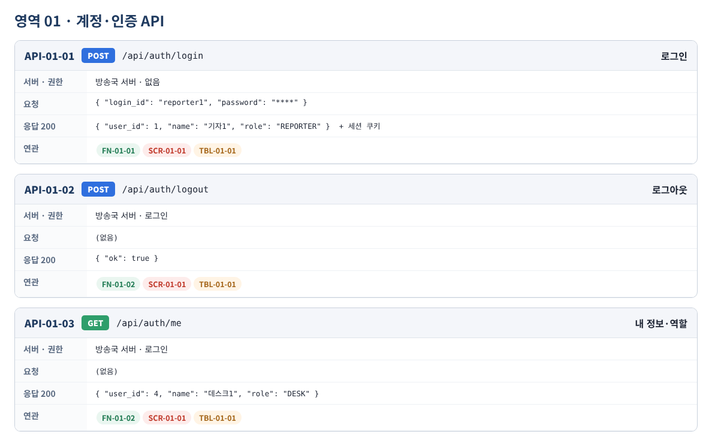</p>
<p align="center"><sub>영역 01 API</sub></p>

#### API-01-01 `POST /api/auth/login` — 로그인
권한: 없음 · 관련 기능 FN-01-01 · 테이블 TBL-01-01

요청
```json
{ "login_id": "reporter1", "password": "****" }
```
응답 200
```json
{ "user_id": 1, "name": "기자1", "role": "REPORTER" }  + 세션 쿠키
```
#### API-01-02 `POST /api/auth/logout` — 로그아웃
권한: 로그인 · 관련 기능 FN-01-02 · 테이블 TBL-01-01

요청
```json
(없음)
```
응답 200
```json
{ "ok": true }
```
#### API-01-03 `GET /api/auth/me` — 내 정보·역할
권한: 로그인 · 관련 기능 FN-01-02 · 테이블 TBL-01-01

요청
```json
(없음)
```
응답 200
```json
{ "user_id": 4, "name": "데스크1", "role": "DESK" }
```

</details>

<details>
<summary><b>영역 02 · 선관위 개표 데이터 API</b></summary>

<p align="center">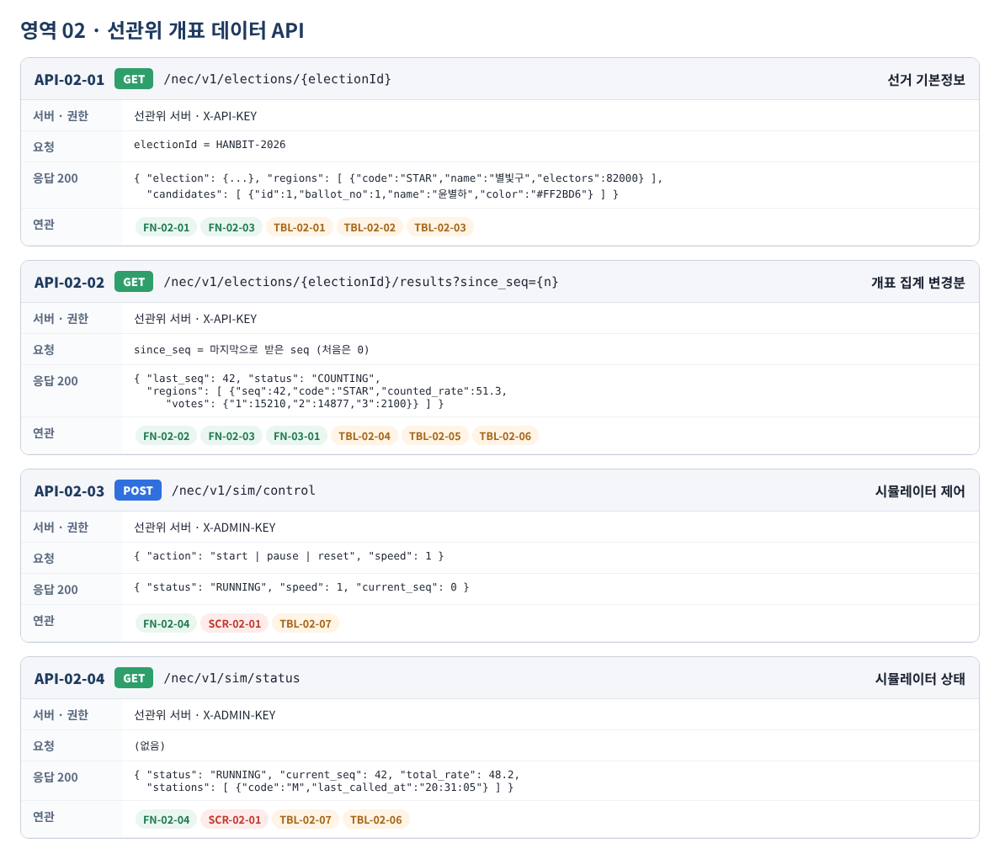</p>
<p align="center"><sub>영역 02 API</sub></p>

#### API-02-01 `GET /nec/v1/elections/{electionId}` — 선거 기본정보
권한: X-API-KEY · 관련 기능 FN-02-01, FN-02-03 · 테이블 TBL-02-01, TBL-02-02, TBL-02-03

요청
```json
electionId = HANBIT-2026
```
응답 200
```json
{ "election": {...}, "regions": [ {"code":"STAR","name":"별빛구","electors":82000} ],
  "candidates": [ {"id":1,"ballot_no":1,"name":"윤별하","color":"#FF2BD6"} ] }
```
#### API-02-02 `GET /nec/v1/elections/{electionId}/results?since_seq={n}` — 개표 집계 변경분
권한: X-API-KEY · 관련 기능 FN-02-02, FN-02-03, FN-03-01 · 테이블 TBL-02-04, TBL-02-05, TBL-02-06

요청
```json
since_seq = 마지막으로 받은 seq (처음은 0)
```
응답 200
```json
{ "last_seq": 42, "status": "COUNTING",
  "regions": [ {"seq":42,"code":"STAR","counted_rate":51.3,
     "votes": {"1":15210,"2":14877,"3":2100}} ] }
```
#### API-02-03 `POST /nec/v1/sim/control` — 시뮬레이터 제어
권한: X-ADMIN-KEY · 관련 기능 FN-02-04 · 테이블 TBL-02-07

요청
```json
{ "action": "start | pause | reset", "speed": 1 }
```
응답 200
```json
{ "status": "RUNNING", "speed": 1, "current_seq": 0 }
```
#### API-02-04 `GET /nec/v1/sim/status` — 시뮬레이터 상태
권한: X-ADMIN-KEY · 관련 기능 FN-02-04 · 테이블 TBL-02-07, TBL-02-06

요청
```json
(없음)
```
응답 200
```json
{ "status": "RUNNING", "current_seq": 42, "total_rate": 48.2,
  "stations": [ {"code":"M","last_called_at":"20:31:05"} ] }
```

</details>

<details>
<summary><b>영역 03 · 방송국 개표 수신 API</b></summary>

<p align="center">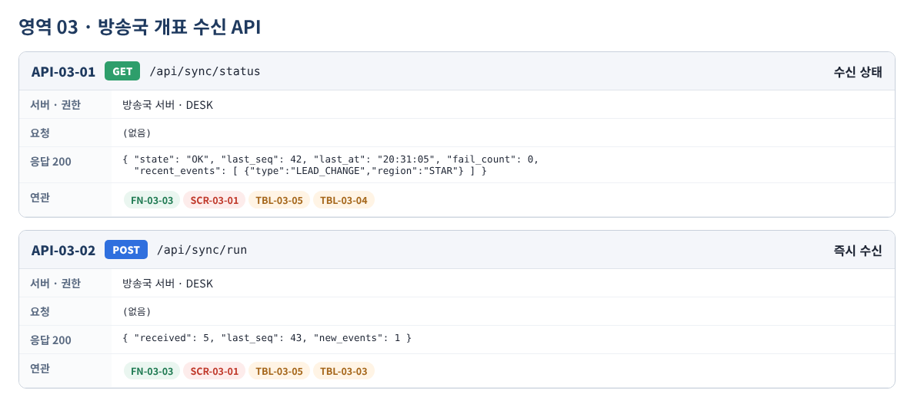</p>
<p align="center"><sub>영역 03 API</sub></p>

#### API-03-01 `GET /api/sync/status` — 수신 상태
권한: DESK · 관련 기능 FN-03-03 · 테이블 TBL-03-05, TBL-03-04

요청
```json
(없음)
```
응답 200
```json
{ "state": "OK", "last_seq": 42, "last_at": "20:31:05", "fail_count": 0,
  "recent_events": [ {"type":"LEAD_CHANGE","region":"STAR"} ] }
```
#### API-03-02 `POST /api/sync/run` — 즉시 수신
권한: DESK · 관련 기능 FN-03-03 · 테이블 TBL-03-05, TBL-03-03

요청
```json
(없음)
```
응답 200
```json
{ "received": 5, "last_seq": 43, "new_events": 1 }
```

</details>

<details>
<summary><b>영역 04 · 기사 자동 생성·송고 API</b></summary>

<p align="center">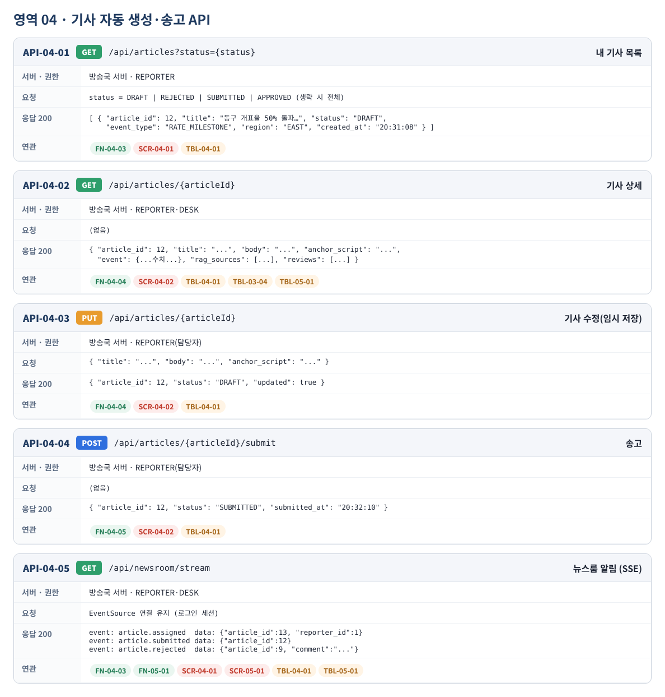</p>
<p align="center"><sub>영역 04 API</sub></p>

#### API-04-01 `GET /api/articles?status={status}` — 내 기사 목록
권한: REPORTER · 관련 기능 FN-04-03 · 테이블 TBL-04-01

요청
```json
status = DRAFT | REJECTED | SUBMITTED | APPROVED (생략 시 전체)
```
응답 200
```json
[ { "article_id": 12, "title": "별빛구 개표율 50% 돌파…", "status": "DRAFT",
    "event_type": "RATE_MILESTONE", "region": "STAR", "created_at": "20:31:08" } ]
```
#### API-04-02 `GET /api/articles/{articleId}` — 기사 상세
권한: REPORTER·DESK · 관련 기능 FN-04-04 · 테이블 TBL-04-01, TBL-03-04, TBL-05-01

요청
```json
(없음)
```
응답 200
```json
{ "article_id": 12, "title": "...", "body": "...", "anchor_script": "...",
  "event": {...수치...}, "rag_sources": [...], "reviews": [...] }
```
#### API-04-03 `PUT /api/articles/{articleId}` — 기사 수정(임시 저장)
권한: REPORTER(담당자) · 관련 기능 FN-04-04 · 테이블 TBL-04-01

요청
```json
{ "title": "...", "body": "...", "anchor_script": "..." }
```
응답 200
```json
{ "article_id": 12, "status": "DRAFT", "updated": true }
```
#### API-04-04 `POST /api/articles/{articleId}/submit` — 송고
권한: REPORTER(담당자) · 관련 기능 FN-04-05 · 테이블 TBL-04-01

요청
```json
(없음)
```
응답 200
```json
{ "article_id": 12, "status": "SUBMITTED", "submitted_at": "20:32:10" }
```
#### API-04-05 `GET /api/newsroom/stream` — 뉴스룸 알림 (SSE)
권한: REPORTER·DESK · 관련 기능 FN-04-03, FN-05-01 · 테이블 TBL-04-01, TBL-05-01

요청
```json
EventSource 연결 유지 (로그인 세션)
```
응답 200
```json
event: article.assigned  data: {"article_id":13, "reporter_id":1}
event: article.submitted data: {"article_id":12}
event: article.rejected  data: {"article_id":9, "comment":"..."}
```

</details>

<details>
<summary><b>영역 05 · 데스크 승인·출고 API</b></summary>

<p align="center">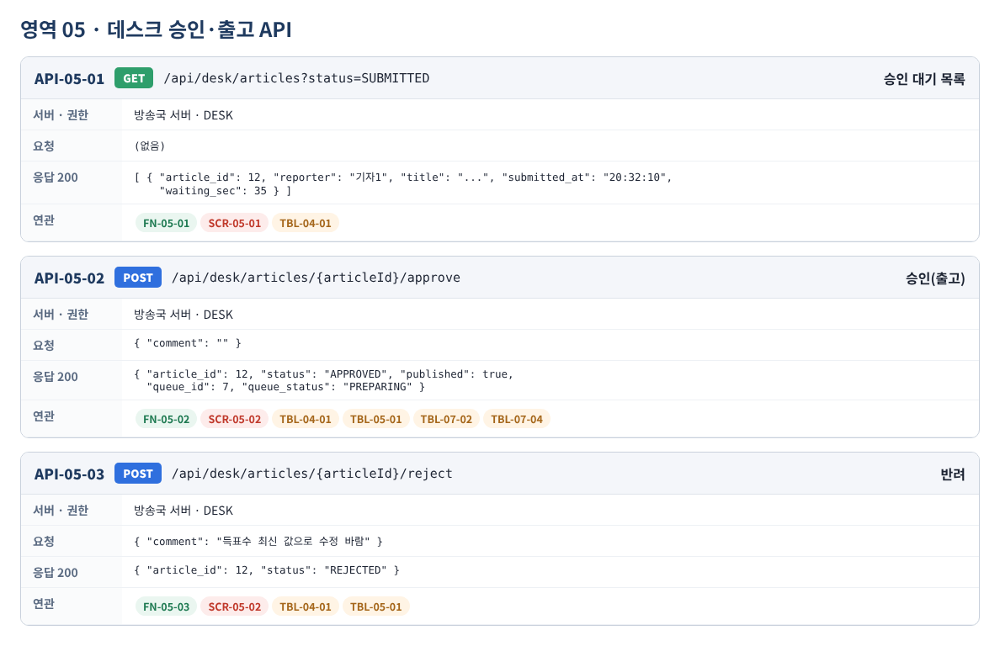</p>
<p align="center"><sub>영역 05 API</sub></p>

#### API-05-01 `GET /api/desk/articles?status=SUBMITTED` — 승인 대기 목록
권한: DESK · 관련 기능 FN-05-01 · 테이블 TBL-04-01

요청
```json
(없음)
```
응답 200
```json
[ { "article_id": 12, "reporter": "기자1", "title": "...", "submitted_at": "20:32:10",
    "waiting_sec": 35 } ]
```
#### API-05-02 `POST /api/desk/articles/{articleId}/approve` — 승인(출고)
권한: DESK · 관련 기능 FN-05-02 · 테이블 TBL-04-01, TBL-05-01, TBL-07-02, TBL-07-04

요청
```json
{ "comment": "" }
```
응답 200
```json
{ "article_id": 12, "status": "APPROVED", "published": true,
  "queue_id": 7, "queue_status": "PREPARING" }
```
#### API-05-03 `POST /api/desk/articles/{articleId}/reject` — 반려
권한: DESK · 관련 기능 FN-05-03 · 테이블 TBL-04-01, TBL-05-01

요청
```json
{ "comment": "득표수 최신 값으로 수정 바람" }
```
응답 200
```json
{ "article_id": 12, "status": "REJECTED" }
```

</details>

<details>
<summary><b>영역 06 · 실시간 개표 웹 API</b></summary>

<p align="center">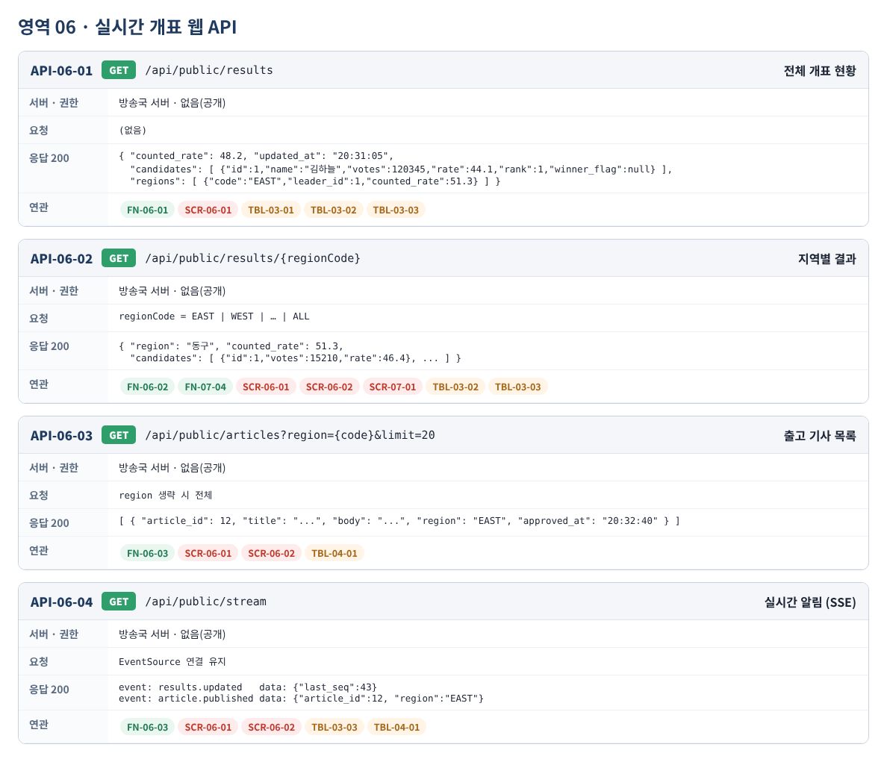</p>
<p align="center"><sub>영역 06 API</sub></p>

#### API-06-01 `GET /api/public/results` — 전체 개표 현황
권한: 없음(공개) · 관련 기능 FN-06-01 · 테이블 TBL-03-01, TBL-03-02, TBL-03-03

요청
```json
(없음)
```
응답 200
```json
{ "counted_rate": 48.2, "updated_at": "20:31:05",
  "candidates": [ {"id":1,"name":"윤별하","votes":120345,"rate":44.1,"rank":1,"winner_flag":null} ],
  "regions": [ {"code":"STAR","leader_id":1,"counted_rate":51.3} ] }
```
#### API-06-02 `GET /api/public/results/{regionCode}` — 지역별 결과
권한: 없음(공개) · 관련 기능 FN-06-02, FN-07-04 · 테이블 TBL-03-02, TBL-03-03

요청
```json
regionCode = STAR | DEEP | DUNE | NEBULA | ORBIT | ALL
```
응답 200
```json
{ "region": "별빛구", "counted_rate": 51.3,
  "candidates": [ {"id":1,"votes":15210,"rate":46.4}, ... ] }
```
#### API-06-03 `GET /api/public/articles?region={code}&limit=20` — 출고 기사 목록
권한: 없음(공개) · 관련 기능 FN-06-03 · 테이블 TBL-04-01

요청
```json
region 생략 시 전체
```
응답 200
```json
[ { "article_id": 12, "title": "...", "body": "...", "region": "STAR", "approved_at": "20:32:40" } ]
```
#### API-06-04 `GET /api/public/stream` — 실시간 알림 (SSE)
권한: 없음(공개) · 관련 기능 FN-06-03 · 테이블 TBL-03-03, TBL-04-01

요청
```json
EventSource 연결 유지
```
응답 200
```json
event: results.updated   data: {"last_seq":43}
event: article.published data: {"article_id":12, "region":"STAR"}
```

</details>

<details>
<summary><b>영역 07 · 개표 방송 송출 API</b></summary>

<p align="center">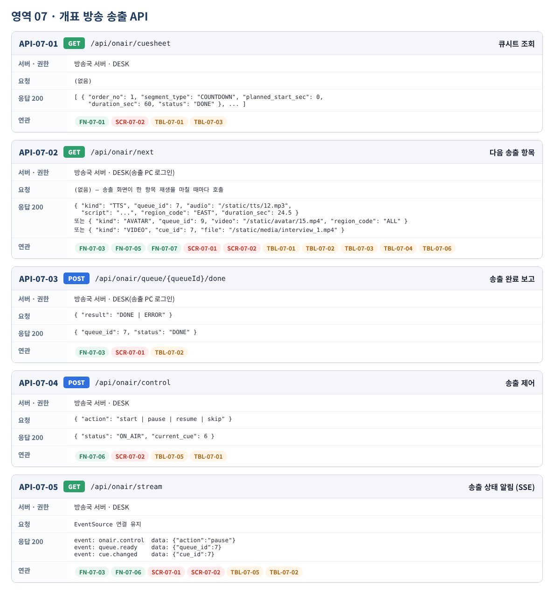</p>
<p align="center"><sub>영역 07 API</sub></p>

#### API-07-01 `GET /api/onair/cuesheet` — 큐시트 조회
권한: DESK · 관련 기능 FN-07-01 · 테이블 TBL-07-01, TBL-07-03

요청
```json
(없음)
```
응답 200
```json
[ { "order_no": 1, "segment_type": "COUNTDOWN", "planned_start_sec": 0,
    "duration_sec": 60, "status": "DONE" }, ... ]
```
#### API-07-02 `GET /api/onair/next` — 다음 송출 항목
권한: DESK(송출 PC 로그인) · 관련 기능 FN-07-03, FN-07-05, FN-07-07 · 테이블 TBL-07-01, TBL-07-02, TBL-07-03, TBL-07-04, TBL-07-06

요청
```json
(없음) — 송출 화면이 한 항목 재생을 마칠 때마다 호출
```
응답 200
```json
{ "kind": "TTS", "queue_id": 7, "audio": "/static/tts/12.mp3",
  "script": "...", "region_code": "STAR", "duration_sec": 24.5 }
또는 { "kind": "AVATAR", "queue_id": 9, "video": "/static/avatar/15.mp4", "region_code": "ALL" }
또는 { "kind": "VIDEO", "cue_id": 7, "file": "/static/media/interview_1.mp4" }
```
#### API-07-03 `POST /api/onair/queue/{queueId}/done` — 송출 완료 보고
권한: DESK(송출 PC 로그인) · 관련 기능 FN-07-03 · 테이블 TBL-07-02

요청
```json
{ "result": "DONE | ERROR" }
```
응답 200
```json
{ "queue_id": 7, "status": "DONE" }
```
#### API-07-04 `POST /api/onair/control` — 송출 제어
권한: DESK · 관련 기능 FN-07-06 · 테이블 TBL-07-05, TBL-07-01

요청
```json
{ "action": "start | pause | resume | skip" }
```
응답 200
```json
{ "status": "ON_AIR", "current_cue": 6 }
```
#### API-07-05 `GET /api/onair/stream` — 송출 상태 알림 (SSE)
권한: DESK · 관련 기능 FN-07-03, FN-07-06 · 테이블 TBL-07-05, TBL-07-02

요청
```json
EventSource 연결 유지
```
응답 200
```json
event: onair.control  data: {"action":"pause"}
event: queue.ready    data: {"queue_id":7}
event: cue.changed    data: {"cue_id":7}
```

</details>

<details>
<summary><b>✅ 테스트케이스 — 1차 확인 (API 테스트 9개)</b></summary>

주소·인증·응답 형식이 명세와 같은지 확인합니다. 두 저장소의 약속(API-02-01·02)이 가장 중요합니다. 단계: 1 선관위 서버 · 2 방송국 수신·웹 · 3 기사 흐름 · 4 송출 · 5 마무리

| 번호 | 단계 | 확인할 것 | 절차 | 기대 결과 | 근거 | 방식 |
|---|---|---|---|---|---|---|
| TC-API-01 | 1 | 선관위 API 키 인증 | X-API-KEY 없이, 틀린 키로, 맞는 키로 차례로 호출한다. | 앞의 두 번은 401, 맞는 키는 200. | API-02-01, API-02-02, REQ-02-03 | 자동 |
| TC-API-02 | 1 | 선거 기본정보 형식 (계약) | API-02-01 응답을 명세의 예시 JSON과 비교한다. | 구 5개·후보 3명이 오고, 필드 이름·자료형이 명세와 같다. | API-02-01, REQ-02-01 | 자동 |
| TC-API-03 | 1 | 개표 변경분 형식 (계약) | API-02-02를 since_seq=0과 최신 값으로 호출한다. | latest_seq와 변경분 목록이 명세 형식대로 오고, 개표율은 0~100 사이다. | API-02-02 | 자동 |
| TC-API-04 | 1 | 시뮬레이터 제어 API | X-ADMIN-KEY 없이 제어를 보낸 뒤, 키를 넣어 start·pause·speed·reset을 보낸다. | 키가 없으면 거부, 키가 있으면 sim/status에 바로 반영된다. | API-02-03, API-02-04 | 자동 |
| TC-API-05 | 3 | 기사 API 권한 (BR-02) | 로그인 없이, 다른 기자 계정으로, 담당 기자 계정으로 기사 수정을 요청한다. | 로그인 없으면 401, 다른 기자는 403, 담당 기자만 200. | API-04-03, API-04-04, API-05-02 | 자동 |
| TC-API-06 | 3 | 승인하면 공개 목록에 | 기사를 승인한 뒤 공개 기사 목록을 부르고, 같은 기사를 한 번 더 승인한다. | 공개 목록 맨 위에 기사가 있고, 두 번째 승인은 409. | API-05-02, API-06-03, REQ-05-02 | 자동 |
| TC-API-07 | 2 | 공개 결과 API | 로그인 없이 전체 결과, STAR 등 5개 구, 없는 코드(XYZ)를 부른다. | 전체·5개 구는 200, 없는 코드는 404. | API-06-01, API-06-02 | 자동 |
| TC-API-08 | 2 | 실시간 알림 (SSE) | 터미널에서 curl -N으로 /api/public/stream에 연결해 둔 채 개표를 진행하고 기사를 승인한다. | 연결이 끊기지 않고, 결과 갱신과 새 기사 알림이 차례로 들어온다. | API-06-04, REQ-06-03 | 수동 |
| TC-API-09 | 4 | 송출 다음 항목 | onair/next로 항목을 받고 done을 보낸 뒤 다시 next를 부른다. 대기열을 비운 뒤에도 부른다. | done 뒤에는 다음 항목이 오고, 대기열이 비면 전체 현황 화면 지시가 온다 (BR-09). | API-07-02, API-07-03 | 자동 |


</details>


</details>

<details>
<summary><b>07 · 시스템설계도 — 구성도·시퀀스·배포</b></summary>

📄 원본: [Google Docs](https://docs.google.com/document/d/1lWL5K6GJTFcwLsETYHts4NMqPekdKXwTzYpBbH3Qf_g/edit) · [Word 파일](docs/07_시스템설계도.docx)

<p align="center">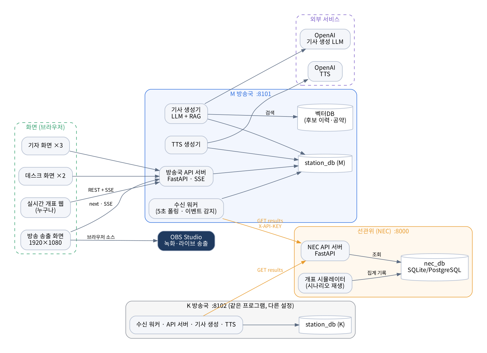</p>
<p align="center"><sub>시스템 구성도</sub></p>

| 구성 요소 | 역할 | 영역 |
|---|---|---|
| NEC API 서버 | 선거 기본정보·개표 변경분 제공 | 02 |
| 개표 시뮬레이터 | 시나리오 CSV를 seq 단위로 기록 | 02 |
| 수신 워커 | 5초 폴링 → result_latest → 이벤트 감지 | 03 |
| 기사 생성기 | 이벤트 → 프롬프트 + RAG → 제목·본문·방송 원고 | 04 |
| 방송국 API 서버 | 로그인·기사·승인·공개·송출 API, SSE | 01·04·05·06·07 |
| TTS 생성기 | 방송 원고 → mp3, 대기열 WAITING | 07 |
| 송출 화면 + OBS | 대기열 재생, OBS 녹화·라이브 | 07 |

<p align="center">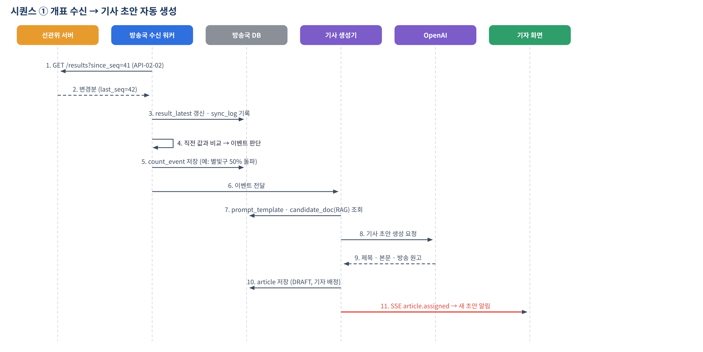</p>
<p align="center"><sub>개표 수신 → 기사 초안 자동 생성</sub></p>

<p align="center">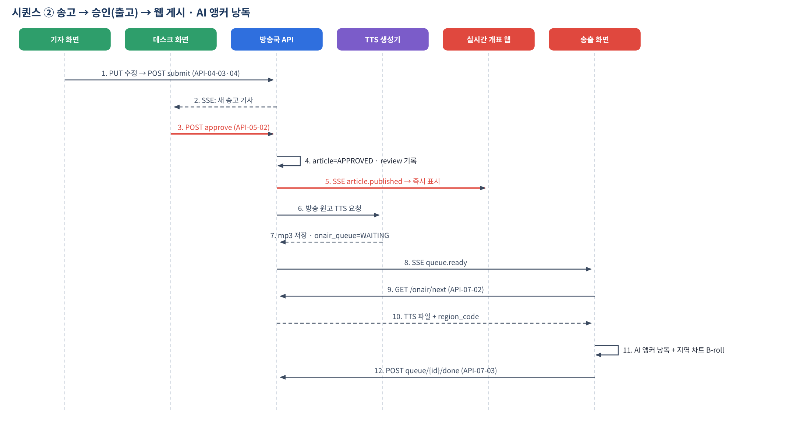</p>
<p align="center"><sub>송고 → 승인 → 웹 게시 · AI 앵커 낭독</sub></p>

<p align="center">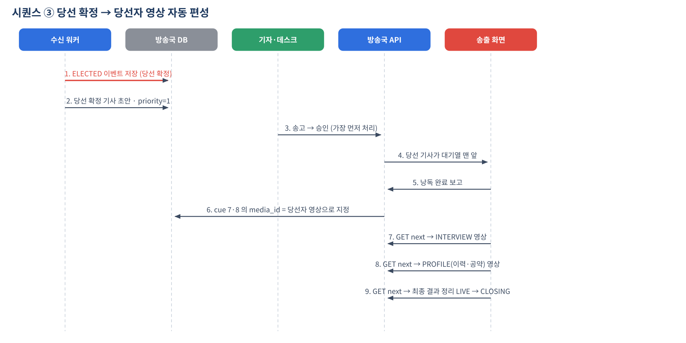</p>
<p align="center"><sub>당선 확정 → 당선자 영상 편성</sub></p>

### 실시간 처리 방식
| 구간 | 방식 | 이유 |
|---|---|---|
| 선관위 → 방송국 | 폴링 5초 (since_seq) | 쉽고, 끊겨도 빠진 seq를 다음에 모두 받음 |
| 방송국 → 웹·기자·데스크 | SSE | 새로고침 없이 갱신, 자동 재연결 |
| 방송국 → 송출 화면 | SSE + GET /onair/next | 알림으로 깨우고 항목은 서버가 정함 |

<p align="center">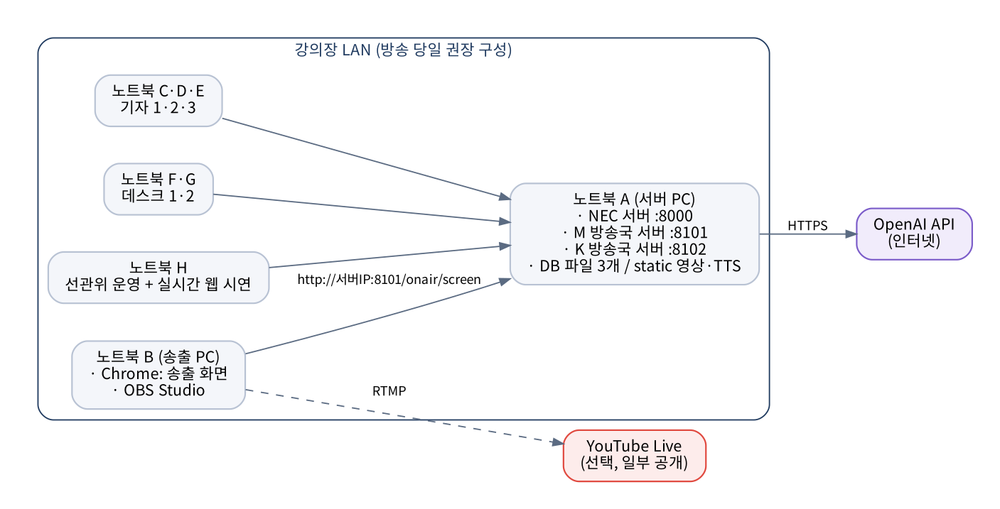</p>
<p align="center"><sub>방송 당일 강의장 LAN 구성</sub></p>

| 서버 | 포트 | 환경 변수 (.env) |
|---|---|---|
| nec_server | 8000 | NEC_DB_URL, ADMIN_KEY, SCENARIO |
| station_server (M) | 8101 | STATION_CODE=M, STATION_DB_URL, NEC_BASE_URL, NEC_API_KEY, OPENAI_API_KEY, LLM_MODEL, TTS_MODEL, TTS_VOICE |
| station_server (K) | 8102 | STATION_CODE=K, K용 값 |

<details>
<summary><b>✅ 테스트케이스 — 1차 확인 (연동·장애 테스트 6개)</b></summary>

서버 3대가 함께 돌 때, 그리고 하나가 멈췄을 때도 방송이 이어지는지 확인합니다. 단계: 1 선관위 서버 · 2 방송국 수신·웹 · 3 기사 흐름 · 4 송출 · 5 마무리

| 번호 | 단계 | 확인할 것 | 절차 | 기대 결과 | 근거 | 방식 |
|---|---|---|---|---|---|---|
| TC-SYS-01 | 2 | 서버 3대 함께 실행 | 선관위(:8000), M(:8101), K(:8102)를 차례로 켠다. | 세 주소 모두 /docs가 열리고, M·K는 각자의 DB 파일에 따로 저장한다. | REQ-03-01 | 수동 |
| TC-SYS-02 | 2 | M·K는 서로 독립 | M 서버만 끈다. | K는 계속 수신하고 웹·송출도 이어진다. | REQ-03-01 | 수동 |
| TC-SYS-03 | 2 | 선관위 장애 뒤 따라잡기 | 개표 중 선관위 서버를 30초 껐다 켠다. | 방송국은 실패를 기록하며 다시 시도하고, 켜진 뒤 빠진 seq를 모두 받아 선관위와 결과가 같아진다. | REQ-03-03 | 수동 |
| TC-SYS-04 | 3 | OpenAI 실패에도 버티기 | OPENAI_API_KEY를 틀린 값으로 바꿔 실행한다. | 기사 생성 실패가 기록되지만, 수신·웹·송출은 멈추지 않는다. | REQ-04-01 | 수동 |
| TC-SYS-05 | 2 | SSE 다시 연결 | 웹을 켜 둔 채 방송국 서버를 재시작한다. | 브라우저가 스스로 다시 연결하고, 새로고침 없이 갱신이 이어진다. | REQ-06-03 | 수동 |
| TC-SYS-06 | 4 | OBS 캡처 | OBS 브라우저 소스로 송출 화면(1920×1080)을 잡고 리허설한다. | 화면이 꽉 차게 잡히고 TTS 소리가 OBS로 들어간다. | REQ-07-02, NFR-05 | 수동 |


</details>


</details>

<details>
<summary><b>08 · 개발환경검토서 — 기술 선택 비교와 권장안</b></summary>

📄 원본: [Google Docs](https://docs.google.com/document/d/1FpMx7I12nRoS6PgpHWRUGGNLTKkPEve9qkVTWQOmv0E/edit) · [Word 파일](docs/08_개발환경검토서.docx)

<p align="center">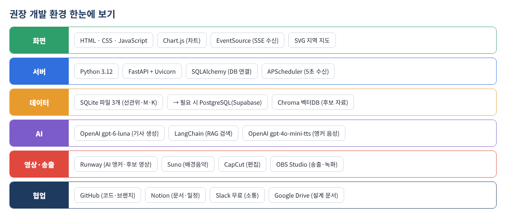</p>
<p align="center"><sub>권장 개발 환경</sub></p>

### 결정 사항 (11/24)
| 항목 | 결정 | 운영 방법 |
|---|---|---|
| DB | SQLite | 서버마다 DB 파일 1개 |
| 실행 장소 | 강의장 LAN + 클라우드 | 본방송은 LAN, 클라우드(Render 무료)는 시연용 — 잠들면 파일이 지워지므로 DEMO_MODE로 seed·자동 재생 |
| OpenAI 키 | 팀 공용 키 1개 | 서버 PC의 .env에만 |
| AI 앵커 | 립싱크 아바타 섞어 쓰기 | 오프닝·마무리는 Runway Lip Sync로 미리 제작, 당선 유력·확실·확정 기사만 실시간 아바타, 나머지는 앵커 영상+TTS |
| 아바타 대기 한도 | 90초 | 넘으면 TTS로 먼저 낭독 (BR-11) |

### 항목별 권장안
| 항목 | 권장 | 다른 후보 | 이유 |
|---|---|---|---|
| 서버 | FastAPI (Python) | Flask, Node.js | 수업에서 사용, 자동 API 문서, SSE·비동기 |
| DB | SQLite 파일 3개 | Supabase PostgreSQL, MySQL | 설치 없음, 서버+DB 구조가 그대로 보임 (Supabase 무료는 활성 프로젝트 2개·1주 비활성 시 일시정지) |
| 실시간 | SSE | WebSocket, 폴링 | 한 방향이면 충분, 간단, 자동 재연결 |
| 화면 | HTML·JS + Chart.js | React, Streamlit | 빌드 없음, 1920×1080 송출 화면 자유 구성 |
| 기사 생성 | gpt-6-luna + LangChain + Chroma | gpt-4.1-mini | 팀 프로젝트 지정 모델, RAG 교재와 같은 구성 |
| TTS | gpt-4o-mini-tts | tts-1, tts-1-hd | 말투 지시 가능 (2027-01-06 종료 예정 — 프로젝트 이후) |
| AI 앵커 | Runway 루프 영상 + TTS | 립싱크 아바타 | 크레딧 적고 실패 위험 낮음 |
| 송출 | OBS Studio | 화면 녹화 | 무료, 녹화·라이브 동시 |

<p align="center">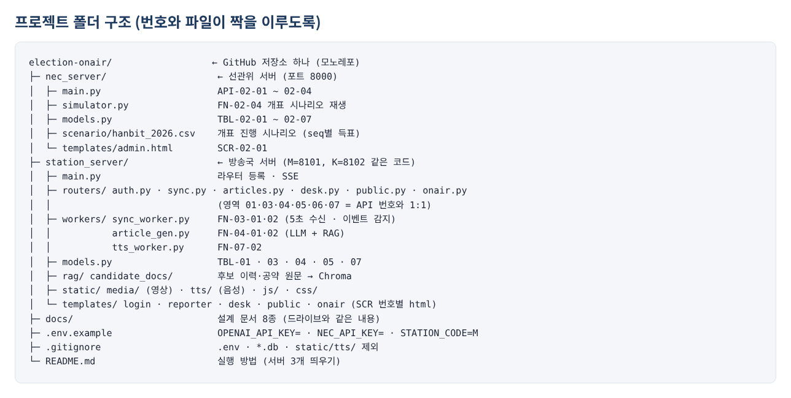</p>
<p align="center"><sub>저장소 폴더 구조</sub></p>

### 협업 규칙 (P1: PR 리뷰 생략, main 하나로)
| 규칙 | 내용 |
|---|---|
| 담당 파일 | 영역 번호대로 파일을 맡는다. 남의 파일을 고쳐야 하면 Slack에 먼저 알린다 |
| 브랜치 | `main`(늘 합쳐진 최신본) ← `feature/영역코드-이름` (예: `feature/04-article-gen`) |
| 합치기 | 팀원 리뷰 없이 **본인이 `main`에 합친다**. 기록이 남도록 PR로 합친다 |
| 합치기 전 확인 | ① 내 PC에서 서버가 켜지는지 ② `.env`·`*.db`가 올라가지 않는지 ③ 커밋·PR 제목에 번호 (예: `FN-05-02 승인 API`) |
| 최신본 받기 | 작업 시작 전 `git pull origin main` |
| 리허설·발표 | 시작 30분 전부터는 `main`에 합치지 않는다 |
| API 계약 변경 | 선관위 API(API-02-01·02-02) 형식을 바꾸기 전에 상대 저장소 담당자에게 Slack으로 알린다 |
| 다음 단계 | P2·P3에서 `dev` 브랜치와 PR 리뷰를 차례로 도입한다 |
### 실행 (터미널 3개)
```bash
uvicorn nec_server.main:app --port 8000
STATION_CODE=M uvicorn station_server.main:app --port 8101
STATION_CODE=K uvicorn station_server.main:app --port 8102
```
브라우저: `:8101/login` (기자·데스크) · `:8101/` (공개 웹) · `:8101/onair/screen` (송출) · `:8000/admin` (선관위)

### 위험과 대응
| 위험 | 대응 |
|---|---|
| OpenAI 비용 | 기사·TTS 각 30건 안팎이라 크지 않을 것으로 예상, 사용량 매일 확인 |
| Runway 크레딧 | 짧게 만들고 정지 이미지 + 자막 움직임으로 대체 가능 |
| 당일 인터넷 | TTS·영상 미리 생성, 서버는 LAN |
| 일정 | ① 수신·기사·승인·웹 → ② TTS·송출 → ③ K 방송국·영상 다듬기 |

### 참고
- [OpenAI Text to speech](https://developers.openai.com/api/docs/guides/text-to-speech) · [OpenAI Deprecations](https://developers.openai.com/api/docs/deprecations)
- [Supabase Pricing](https://supabase.com/pricing) · [Supabase Project Pausing](https://supabase.com/docs/guides/platform/project-pausing)
<details>
<summary><b>✅ 테스트케이스 — 1차 확인 (환경 확인 7개)</b></summary>

새 PC에서 설치·설정·실행이 되는지, 비밀 정보가 Git에 올라가지 않는지 확인합니다. 단계: 1 선관위 서버 · 2 방송국 수신·웹 · 3 기사 흐름 · 4 송출 · 5 마무리

| 번호 | 단계 | 확인할 것 | 절차 | 기대 결과 | 근거 | 방식 |
|---|---|---|---|---|---|---|
| TC-ENV-01 | 1 | 새 PC 설치 | README 순서대로 가상환경을 만들고 pip install -r requirements.txt를 실행한다. | 오류 없이 설치되고 서버가 켜진다. | NFR-02 | 수동 |
| TC-ENV-02 | 1 | .env 준비 | .env.example을 복사해 값을 채운다. 값 하나를 일부러 비우고 다시 실행한다. | 값이 다 있으면 실행되고, 빠지면 어떤 값이 없는지 알려 주며 멈춘다. | NFR-02 | 수동 |
| TC-ENV-03 | 1 | Git에 올리지 않을 것 | 서버를 돌린 뒤 git status를 본다. | .env, *.db, vectordb/, 큰 영상 파일이 목록에 나오지 않는다. | NFR-02 | 자동 |
| TC-ENV-04 | 2 | 강의장 LAN 접속 | 같은 강의장의 다른 PC·휴대폰에서 http://서버IP:8101을 연다. | 실시간 개표 웹이 열린다 (막히면 방화벽 허용). | REQ-06-04 | 수동 |
| TC-ENV-05 | 5 | Render 배포 | Render에 배포하고 15분 뒤 다시 접속한다. | 잠들었다가 1분 안에 깨어나고, 시연 모드로 자동 재생된다. | REQ-02-05 | 수동 |
| TC-ENV-06 | 3 | gpt-6-luna 연결 | 짧은 요청 1회를 보낸다. | 응답이 오고, 쓰인 모델 이름이 .env 설정값(gpt-6-luna)과 같다. | REQ-04-01 | 수동 |
| TC-ENV-07 | 4 | TTS 연결과 발음 | '기호 1번 윤별하, 2번 류해온, 3번 오로라' 한 문장을 TTS로 만든다. | 음성 파일이 재생되고, 세 이름이 바르게 읽힌다 ('류해온'이 '유해온'으로 들려도 되는지 팀이 정함). | REQ-07-02 | 수동 |


</details>


</details>

## 🧪 테스트 실행 가이드

설계 문서의 1차 확인 테스트케이스 61개를 실제로 돌려 보는 순서·명령·기대 결과: **[docs/TEST_GUIDE.md](docs/TEST_GUIDE.md)** (준비 → 자동 테스트 → 단계별 수동 테스트 → 결과 기록표)

## 📝 개정 이력

| 버전 | 일자 | 내용 |
|---|---|---|
| v0.1 | 2026-11-25 | 초안 작성 |
| v0.2 | 2026-11-25 | 1차 검토(번호 정합성 자동 검사): 요구·기능·화면·API·테이블 상호 참조 확인, 연결이 빠진 NFR-02·NFR-05를 해당 기능에 연결, 큐시트 합계 20분(1,200초) 확인 |
| v0.3 | 2026-11-25 | 2차 검토(내용·예외 흐름): 뉴스룸 알림 API(API-04-05)를 공개 알림과 분리, 송출 화면 인증을 데스크 로그인으로 단순화, 오래된 기사 건너뛰기·동시 승인 방지·TTS 재생성·기자 배정·당선 지연 대비 규칙 추가, 오프닝 음성 저장 위치(media_asset) 명시 |
| v1.0 | 2026-11-25 | 3차 검토(문서 렌더링·문서 간 일치): 이미지 겹침·잘림 수정, 문서 8종의 번호·용어(송고·승인·출고) 통일 확인, Google Docs 변환 후 이미지 표시 확인 |
| v1.1 | 2026-11-25 | 개발환경 결정 반영: SQLite, LAN+클라우드(시연 모드 REQ-02-05), 팀 공용 OpenAI 키, 립싱크 아바타 섞어 쓰기(REQ-07-06, FN-07-07, TBL-07-06, BR-11) |
| v1.2 | 2026-11-25 | 후보·지역 콘셉트 확정: 우주 SF 분위기의 가상 후보 3명(윤별하·류해온·오로라)과 이력·공약, 네온 후보색, 5개 구 이름(별빛구·심해구·사막구·성운구·궤도구, 코드 STAR·DEEP·DUNE·NEBULA·ORBIT), 방송 화면 차트를 어두운 배경으로 변경 |
| v1.3 | 2026-11-25 | 1차 확인 테스트케이스 추가: 8개 문서마다 마지막 장에 테스트 표(시나리오·인수·기능·화면·데이터·API·연동·환경), 요구사항 정의서에 요구사항 → 확인 테스트 추적표, 구현 단계(1~5)별 통과 기준 |

